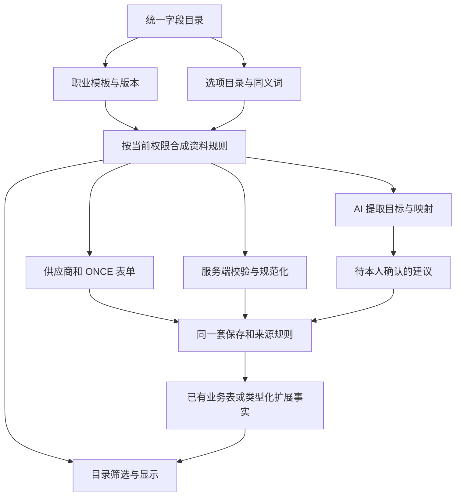

# ONCE 供应商资料字段 标签与职业模板升级方案

日期：2026 年 11 月 7 日，北京时间。状态：**核心升级已接通，验收中；未部署**。本方案细化[供应商库原方案](ONCE_SUPPLIER_LIBRARY_V1_20261106.md)的专业字段机制；当前实际功能仍以[实施记录](../release/SUPPLIER_LIBRARY_V1_IMPLEMENTATION.md)和[作品整理记录](../release/SUPPLIER_WORK_GROUPING.md)为准。

第一版继续聚焦人、资料、材料和作品，采用“本人确认直接入库，ONCE 随时整理纠正”。这次升级解决两件事：不同职业需要不同资料项；使用过程中发现新字段、新标签时，可以逐步加入，同时保持旧资料可读、可查、来源可追溯。

推荐采用**稳定业务主档、受控字段目录、职业模板、类型化专业事实**的混合结构。标签用于适合分类的信息，多选是取值规则，胶囊按钮是显示方式；三者由同一个字段定义组织。AI 与人工填写使用同一份已发布定义。

当前实现和真实材料校准见[字段模板实施记录](../release/SUPPLIER_FIELD_TEMPLATES.md)及[真实材料校准](REAL_MATERIAL_FIELD_CALIBRATION_20261107.md)。实现保留旧 v1 草稿载体，以独立版本的 professional 子协议渐进接入；已有主档、能力、资格、翻译与量尺走原生业务适配，普通扩展字段由目录驱动。下述目标设计中的完整迁移导出、合并裁决和真实业务试点尚未全部完成，不能以本稿替代实施记录。

配套[首批目录示例](examples/once-field-tag-catalog-v1.proposal.json)包含 33 个字段定义、18 个选项集引用或示例、1 套通用模板和 7 套职业模板。它用于讨论和实施验收，未加载到业务数据库；具体职业用语、选项和旧代码映射仍需真实资料校准。

## 1 当前基础与需要升级的部分

| 层次 | 当前实际实现 | 本次升级目标 |
|---|---|---|
| 人与职业 | Person、TalentProfile、PersonRole；一人多职业 | 保留同一 Person 和职业记录，不按职业复制人物 |
| 基础资料 | 姓名、别名、介绍、职业、城市、语言、技能、联系方式 | 统一登记含义和展示规则；继续写入原有业务表 |
| 选项 | DictionaryItem 和 CapabilityDefinition 可维护选项、能力、别名和适用职业 | 形成有稳定代码、版本、别名和停用规则的选项目录 |
| 模特资料 | 本人端开放身高、三围；底层还有鞋服尺码和量尺历史 | 补齐量尺组、尺码体系，支持增加肩宽等新项目 |
| 其他职业 | 共用职业、技能、资料和作品；缺少完整专属模板 | 按职业组合字段，支持同一人多职业的表单合成 |
| 字段结构 | SupplierProfileSchema、管理端字段描述和 AI 白名单主要在代码中维护 | 由统一目录驱动表单、服务端校验、AI 映射和筛选 |
| 标签 | 已有模特风格、服务类型和媒体集合标签，语义与归属不同 | 明确职业标签、作品分类、素材标签和内部整理标签的边界 |
| 搜索 | 有职业、地区、部分能力及作品维度；维度与查询代码固定 | 新字段采用版本化过滤协议，并保持权限、来源和职业绑定 |
| AI | 真正提取 PDF；结构化字段与未知提示有固定合同 | 使用版本化目录，保留未匹配信息，支持字段或选项提议 |

实现依据：[本人资料结构](../../packages/core/src/supplier-profile-schema.ts)、[表单选项接口](../../packages/core/src/supplier-profiles.ts)、[管理端字段描述](../../apps/admin-web/src/talent-fields.ts)、[能力登记](../../packages/core/src/talent-v2.ts)、[AI 字段清单](../../packages/core/src/document-schema.ts)、[目录筛选](../../packages/core/src/talent-v2-search.ts)。

现有目录和能力登记是可复用基础，但它们还不能替代通用字段系统。职业相关字段尚未全部进入供应商端；例如鞋服尺码的底层结构已经存在，当前本人预填只贯通四个数值量尺。

## 2 信息采用什么表达方式

### 2.1 决策表

| 信息 | 推荐表达 | 原因和边界 |
|---|---|---|
| 姓名、联系方式、人员身份 | 固定业务字段或关系 | 参与身份、加密、权限及关联，沿用原模型 |
| 身高、肩宽、胸围 | 数值＋单位＋量尺记录 | 需要范围查询、单位归一和记录时间 |
| 量尺日期 | 日期＋准确度或未知 | 不能把上传日期冒充测量日期 |
| 鞋码、衣码 | 尺码值＋尺码体系 | EU 42、US 9、M 分属不同体系，不能统一当厘米 |
| 本人声明的服务方向 | 受控标签，多选 | 如汽车、美妆；有统一选项代码和职业归属 |
| 创作风格、摄影技能、剪辑流程 | 按维度组织的受控标签，多选 | 风格、行业、工作流程各自成组，避免混成一个标签堆 |
| 当前记录状态 | 单选状态字段 | 有限、互斥；默认未填写不代表某个确定状态 |
| 软件及熟练程度 | 可重复记录组 | 每一行保存软件与对应等级，不能拆成两个不相关的列表 |
| 常驻城市、可服务城市 | 引用城市字典的两个多选字段 | 同一个城市目录，两种不同含义 |
| 专业资格 | 原有资质关系＋证明及有效期 | “会航拍”标签不等于持有有效执照 |
| 作品与本人职责 | Work、WorkCredit、素材引用 | 某个项目的职责不能变成整个人的永久属性 |
| ONCE 的“本季备选、优先回访” | 内部整理标签 | 不代表供应商的职业能力，不向本人和外部模型开放 |
| 暂时无法归类的信息 | 其他补充＋待整理原文 | 先接住有用信息，再决定是否升级成正式字段或选项 |

**多选字段可以显示为标签，但标签的外观不决定数据含义。** “工作语言”可以用胶囊按钮多选，它保存的仍是语言代码；“身高 178”保存为数值，界面也可以把它显示成摘要标签。

“已核验”“已归档”“本人已接手”等已有业务状态继续由相应流程产生，不允许通过添加同名标签获得该状态或权限。

### 2.2 标签的三类使用方式

| 类别 | 示例 | 谁定义、谁填写 | 是否进入专业筛选 |
|---|---|---|---|
| 专业受控标签 | 服务方向、创作风格、熟悉设备 | ONCE 管目录；本人填写，或确认有出处的 AI 建议 | 是，按具体字段和职业筛选 |
| 内部整理标签 | 本季备选、优先回访、重点关注 | ONCE 管理人员定义、添加和移除 | 仅有权限的内部人员可用 |
| 未归一内容 | 新软件名称、暂不在目录中的服务描述 | 本人补充或 AI 保留原文，ONCE 整理 | 不混入正式枚举筛选，可按获准的补充文本查找 |

专业标签不提供不受控的“敲回车即新建全局标签”。用户可以选“其他并补充”，提交原文；本次资料正常确认，不必等待目录管理员处理。管理员随后选择映射已有选项、登记新选项或保留为补充说明。

## 3 一个字段如何同时驱动表单和 AI



目录分清三件事：

1. **字段是什么。** 稳定标识、含义、所属对象、值类型、单位、引用的选项集。
2. **何时怎样问。** 哪些职业显示、排序、帮助文字、选填或必填、简单显示条件。
3. **实际填了什么。** 具体人员或职业、值、来源、观察时间、确认者、历史版本。

姓名和联系方式依旧写原有表；受控字段目录可以为它们提供统一描述，但不能把受保护的业务字段切换到普通扩展存储。显示组件与数据类型独立，例如 `CODE_SET` 可以使用胶囊多选、搜索多选或勾选列表。

### 3.1 字段登记示例

| 属性 | 服务方向 | 肩宽 | 软件能力 |
|---|---|---|---|
| 稳定标识 | role.practice_industries | measurement.shoulder_width_cm | role.capabilities |
| 所属对象 | 某个人的某项职业 | 某个人的某次量尺记录 | 某个人的某项职业 |
| 值类型 | 无重复代码集合 | 数值 | 可重复的能力记录 |
| 界面 | 标签多选，可搜索 | 数值框，显示厘米 | 一行一个软件和熟练度 |
| 选项或单位 | 行业选项集 | cm | 能力目录中的软件分类及其等级方案 |
| 筛选 | 包含任意项／包含全部项 | 数值范围 | 同一条能力记录满足软件和等级 |
| 来源 | 每个选中项可分别关联出处 | 数值及记录时间的出处 | 每一行有自己的出处 |

软件是专业能力的一种视图，同一来源的软件能力记录只保存一份。“软件能力”和“其他能力”分区引用同一个规范字段及记录身份，不能因为界面有两个分区就复制事实。不同来源对同一能力的声明可以分别保留，不以界面去重为由抹掉来源或等级冲突。

### 3.2 首批支持的组件

首批支持短文本、长文本、数值及单位、单选、多选代码集合、日期及准确度、已实现的联系方式/尺码组件、最多一层的重复能力组，以及既有作品和私有素材引用。复杂附件访问仍由媒体服务负责。

常规字段可以配置新增；新增一种全新的复杂值类型或业务流程，需要开发对应存储适配器和控件。首版字段配置不开放任意 JavaScript、SQL、无限嵌套表单和自定义执行脚本。显示条件使用受限的“等于、包含、有填写、全部／任一”，发布时检查循环依赖。

首轮建议限额为：每个职业模板最多 50 项、合成表单最多 80 项、单个多选最多 30 项、每职业能力组最多 30 行、重复组最多一层，v2 资料值载荷最多 1 MiB。各字段可以收紧上限，超限明确提示，不静默截断。选项目录分页检索，不受一屏展示数量限制。这些是拟实施默认值，不改变现有 v1 的限额。

## 4 标签目录与选项治理

### 4.1 固定代码、名称与别名

字段与选项都使用稳定代码。名称可以调整，旧名称可以成为别名；不能把同一个代码改作不同含义。

| 原文 | 处理 |
|---|---|
| Premiere、Premiere Pro、PR | 在软件目录上下文中，经登记的别名映射到同一个能力代码 |
| DaVinci Resolve、达芬奇 | 目录确认同义后归到同一软件能力，保留原文 |
| “商业” | 必须结合字段语境判定，不能在行业、作品类型、风格之间直接等同 |
| 某个新软件或歧义缩写 | 保留原文和出处，请求确认；不自动创建正式代码 |

归一化可以处理首尾空格、约定的大小写和明确同义词。模糊近似只生成建议，不自动合并。相同文字在不同命名空间中可以有不同意义。

受控词表使用“标准名称、别名、含义、稳定代码、所属选项集”的组织方式，可借鉴 [W3C SKOS 的标签与概念机制](https://www.w3.org/TR/skos-reference/#labels)。本项目按实际需要实现轻量词表，不引入 RDF 或图数据库。

### 4.2 分组与层级

优先按字段分组，例如“服务方向”“创作风格”“熟悉设备”，避免一千个标签放在同一个选择器里。分类层级先限制为两至三级；普通列表不强制建树。

如果有“汽车 → 新能源汽车”，只选择父项不能证明擅长子项。子项归属父项可以用于明确标注的“含下级分类”筛选，保存时仍记录本人真正选择的项。层级不能成环，跨组关系不能当作同义合并。

### 4.3 新增、改名、停用和合并

| 动作 | 规则 |
|---|---|
| 新增选项 | 在已有字段下补选项，无需新增一个同名字段；发布新目录版本 |
| 改显示名称 | 保持代码，保留旧名称为别名；历史记录可展示当时名称和现名 |
| 停用选项 | 新填写不可选；旧记录仍能解释，已有值不因一次无关编辑被清空 |
| 合并同义项 | 先看受影响记录和出处；登记映射与审计，不直接覆盖原始来源和历史值 |
| 修改含义或拆分 | 建新代码；旧记录保留原义，需明确核对后迁移 |
| 删除定义 | 已发布且被引用的定义禁止物理删除；只允许停用。业务删除仍按隐私和保留机制执行 |

目录发布前预览字段涉及多少模板、哪些旧值，以及是否影响 AI 任务和保存中的草稿。目录管理员的操作不进入供应商普通资料确认流程，也不把所有本人更新改为内部审核。

旧字典和能力登记接口的变更也必须进入目录兼容校验。兼容期可以先在新版目录停止提供某选项，不能直接停用一个仍被 v1 完整保存协议要求为 ACTIVE 的底层字典项，造成旧用户无法保存；先完成适配，再做底层状态转换。

## 5 首批职业模板

### 5.1 共用部分

所有职业共享人员身份、联系方式、常驻城市、可服务城市、工作语言、本人介绍、作品与材料。主档只存一份。作品链接可以新增受约束的链接记录；保存链接不自动授权抓取外部网页。

常驻城市与可服务城市分别保存。工作语言与编剧写作能力也不混为一项：后者需要明确的职业能力声明，不能仅凭会说某种语言推断。

### 5.2 按职业组合专业资料

| 职业 | 首批专业部分 | 采用形式 |
|---|---|---|
| 模特 | 量尺与日期、鞋服尺码、本人声明的风格、愿意提供的服务 | 数值记录组、尺码组合、受控多选 |
| 导演 | 服务方向、作品类型方向、创作风格、熟悉的摄影机系统、代表作品 | 分类多选、作品引用 |
| 编剧 | 服务方向、作品形式、题材、专业能力、作品简介或链接 | 分类多选、能力记录、文本及链接 |
| 摄影师／摄影指导 | 服务方向、摄影技能、熟悉机型、软件能力、作品 | 分类多选、软件与等级记录、作品引用 |
| 灯光师 | 服务方向、灯光职责、熟悉的控制协议、代表案例 | 分类多选、案例引用 |
| 剪辑师 | 成片类型、软件能力、剪辑流程、交付经验、作品 | 多选、能力记录、作品引用 |
| 调色师 | 软件能力、色彩管理流程、交付标准、作品 | 能力记录、多选、作品引用 |

这些是首批组织方式，具体候选选项还需从 ONCE 实际资料中整理。摄影师、摄影指导等相近名称的字典映射需要人工确定，不能仅凭缩写自动认定为同一职业。化妆、造型、录音等未细化职业先使用通用资料、能力和补充说明，随后增加模板。

**声明的方向与作品事实分别保存。** 例如本人声明擅长汽车，可以成为职业服务方向；某一作品属于汽车行业，保存到作品行业。它们可共用行业选项目录，但一条汽车作品不能自动升级为“擅长汽车”的正式能力事实。

软件等级增加适合软件的方案，如“了解、能独立完成常规工作、能处理复杂工作”。现有能力等级包含“流利、母语”，不适合作为所有软件的等级。旧等级保留，明确适用的值才经核对映射；等级阈值只在同一等级方案内比较。

### 5.3 多职业表单合成

同一个人选择“导演＋摄影师”时，通用资料显示一次，两个职业各有专业分区。相同字段如果属于职业，分别归到各自的 PersonRole；同一个人的身体量尺属于观察记录，模板只是决定在哪个界面展示。

去掉某个职业先停用该职业的当前维护入口；已有作品署名、来源与历史资料保留。隐藏字段不等于删除。重新启用职业时展示可用旧资料供核对，不自动把过期声明恢复成当前事实。现有 H5 移除模特时清空本次草稿量尺的行为，需要在切换新版时改成明确的保留／移除说明和受控兼容策略。

## 6 人员填写和 ONCE 管理体验

### 6.1 供应商表单

```text
我的资料
  基本资料：姓名、联系方式、城市
  我的职业： [导演 ✓] [摄影师 ✓] [灯光师]

  导演资料
    服务方向： [汽车 ✓] [美妆 ✓] [食品]  搜索其他方向
    创作风格： [纪实 ✓] [叙事] [喜剧]

  摄影师资料
    熟悉机型： [ARRI ALEXA ✓] [RED]  搜索机型
    软件能力： Capture One | 能独立完成常规工作
              Photoshop  | 能处理复杂工作
              ＋添加一条

  没有合适选项？补充原文
  核对变化 → 确认入库
```

一屏先显示少量常用选项，长列表采用搜索和展开，已选项始终可见。选择数量有上限，保存去重后的代码集合。常用排序可由 ONCE 维护，不按标签数量或资料完整度给人员能力打分。

界面区分未填写、不知道、明确没有和拒绝提供；没有操作时不默认选择“没有”。有值的布尔字段可以是明确的否，未填写不能自动变成否。非适用字段不要求填写，条件隐藏时保留历史并提示本次变化。

### 6.2 ONCE 设置入口

先提供能完成实际任务的三个入口：

1. **字段和选项。** 选择字段类型、所属对象、单位／选项集、显示名称和说明，配置可见与可编辑范围。
2. **职业模板。** 选择现有字段、分组和排序，预览单职业和多职业的手机表单。
3. **待整理信息。** 查看未识别字段／选项的原文、来源和出现次数，选择映射、登记或保留说明。

每次发布展示新旧差异和影响范围，保留可恢复的已发布版本。发布新版本不启动全库付费 AI 重解析，也不直接更新任何人的正式资料。

## 7 存储与领域模型

### 7.1 混合存储的取舍

| 方式 | 适用性 | 决策 |
|---|---|---|
| 每加字段就给人物表加一列 | 稳定核心字段适合；职业变化会带来大量空列和反复迁移 | 核心结构保留，新职业长尾字段采用扩展事实 |
| 每个人一个任意 JSON | 初期灵活；类型、来源、筛选和权限容易分散 | 草稿与元数据快照可用受约束 JSON，不作为无规则正式资料模型 |
| 所有资料都是字符串标签 | 简单分类方便；数值范围、时间和组合关系无法可靠表达 | 只用于真正的分类或内部整理 |
| 全部改成通用属性表 | 扩展统一；会重复造身份、作品、联系方式和既有业务规则 | 保留专门业务表，扩展只覆盖没有合适原模型的新事实 |
| 稳定主档＋类型化扩展事实＋受控选项 | 兼顾现有约束、职业差异和可扩展查询 | **推荐** |

PostgreSQL 的 JSONB 支持 GIN 和表达式索引，但索引方式有取舍，不能据此假定任意扩展字段都天然具备良好查询性能。此处按 [PostgreSQL 16 文档](https://www.postgresql.org/docs/16/datatype-json.html#JSON-INDEXING)选择具体检索结构，沿用当前数据库版本。

### 7.2 拟新增的逻辑实体

以下是设计实体，具体迁移会在实施阶段补齐；不表示已有表或接口。

| 实体 | 职责与关键约束 |
|---|---|
| ProfileFieldDefinition / FieldVersion | 稳定代码、所属对象、存储适配器、版本化类型规则；已发布版本不可原地改写 |
| ProfileOptionSet / OptionTerm | 选项集、稳定选项代码、别名、层级、停用状态；旧字典和能力目录通过适配器接入 |
| RoleTemplateVersion / TemplateBinding | 职业模板版本、引用的字段版本、布局、条件、选项视图；禁止覆盖字段原本含义 |
| ProfileCatalogVersion | 一次发布的完整依赖快照和摘要，固定字段、模板、选项及策略版本 |
| ProfileSubject | 扩展事实的明确归属；关联 Person、PersonRole 或 MeasurementSet，使用同工作区复合外键 |
| ProfileFact | 每来源的类型化事实版本、值状态、观察时间、确认主体、替代关系；无对应原业务表的新字段写这里 |
| ProfileFieldState | 原业务表不能表达的明确无值声明及其依赖版本，不重复存放原字段值；已有原生状态优先使用原生结构 |
| ProfileFactOption | 集合型事实的选项成员，唯一约束 factId＋optionId，明确关联所属选项集 |
| ProfileFactEvidence | 事实或选项成员的来源、材料、页码、区域、值摘要；保留实际确认者，不冒充员工审核 |
| PendingProfileConcept | 未匹配字段／选项原文、位置、所属草稿和待整理状态，沿用草稿保留与撤回规则 |
| InternalTagAssignment | ONCE 内部整理标签与人员的关系、操作人及依据，独立权限域 |

一个字段只有一个权威写入路径。旧业务字段绑定原表适配器，不再另存一份 ProfileFact；能力的不同显示视图也不能生成重复记录。目录中的词条可以引用既有 DictionaryItem 或 CapabilityDefinition，不能建立两份独立维护的同义目录。

ProfileSubject 不接受“任意对象类型＋任意字符串 ID”。PersonRole 必须属于同一人，MeasurementSet 必须属于同一人；所有关联受工作区、外键和领域校验共同约束。作品和素材继续使用其原有授权与关系模型。

### 7.3 类型、集合和缺失状态

数值、布尔、日期、短文本使用对应的类型化列；选项集合使用成员关系。只有已经实现专门验证器的复合值才可保存有界的结构化载荷。类型与已发布 FieldVersion 一致，不能把任意文本写入数值字段。

值状态也受类型和字段规则约束：数值、文本和布尔不使用 DECLARED_NONE；该状态仅对明确允许的集合开放，职业等确认时必填集合不能声明为空。旧业务适配器优先使用现有日期准确度等原生状态；没有相应结构时由 ProfileFieldState 保存明确声明和依赖摘要。旧入口改动底层值时，必须同步使旧状态失效或进入冲突核对，避免值已经改变却仍显示“明确没有”。

| 状态 | 含义 | 例子 |
|---|---|---|
| KNOWN | 有明确值，布尔值可以是 false | 肩宽 42，或明确表示不能提供某项服务 |
| DECLARED_NONE | 本人明确声明某个集合没有项目 | 明确表示没有某类设备；不等于未填 |
| UNKNOWN | 用户明确表示不知道 | 不知道本次量尺日期 |
| NOT_PROVIDED | 未提交该项，一般由缺少记录表示 | 新字段尚未补充 |

无权限或来源不可用是读取状态，不是上述业务值，不能通过“未知／未填”的人数统计泄漏隐藏信息。只有具有适用字段且当前有权读取的事实才能进入分面计数。

### 7.4 来源、确认与并发

每个可采纳的值或集合成员保留出处；同组标签可以来自不同页、不同材料。记录区分 AI 建议、本人声明和内部核验，旧值的核验不能自动证明新值。

继续沿用当前来源可用性、本人 exposure、用途撤回、保护版本和命令回执协议。本人只能修改明确开放的事实或创建自己的新声明；“清空多选”不能退休未向本人开放的员工事实。ONCE 纠正时也必须在当前权限与来源下明确保存。

旧业务字段适配器必须先验证它能表达需要的来源粒度。原数组列若不能区分成员来源，必须完成相应的证据和授权适配后才开放该写入；不能用“统一表单”名义直接替换整个共享数组。新事实保存自己的来源，不重指向别人的历史声明。

初期继续使用草稿及 Person 的版本检查保证一次确认原子生效。界面按字段显示差异，并非已经提供无冲突的逐字段并行保存。后续若引入更细版本，需要同时覆盖事实成员、来源及模板依赖，不能仅比较表单显示值。

## 8 目录发布与数据演进

### 8.1 发布流程

```text
编辑目录草稿
  → 校验定义、依赖、权限和代码唯一性
  → 预览表单、AI 目标和筛选
  → 展示影响范围
  → 原子发布不可变目录版本
  → 新草稿使用新版本，旧资料继续可读
```

目录发布使用内部目录管理权限和命令回执。供应商及机器主体不能发布定义。并发发布按期望目录版本校验，一次发布要么全部成功，要么全部不生效。

### 8.2 常见变更的兼容规则

| 变更 | 新写入 | 旧资料与旧草稿 |
|---|---|---|
| 新增选填字段 | 新表单显示 | 原值缺失，提示可补，不制造“零／否／没有” |
| 新增职业模板 | 新职业可使用 | 同一 Person 可新增职业，不复制主档 |
| 调整标题、排序和提示 | 显示新版 | 同一稳定含义可兼容，保留快照以解释原填写过程 |
| 增加选项 | 新目录可选择 | 旧草稿仍按记录版本解释；需要新项时明确刷新目录 |
| 收紧必填或范围 | 发布时明确影响规则 | 不让全部旧档案突然失效；已有值可读，相关项编辑时提示核对 |
| 停用字段或选项 | 不再新增 | 历史可读，不能因完整表单提交而丢掉旧值 |
| 改类型、单位或含义 | 新定义或明确转换流程 | 保存原值、原单位和转换依据，禁止原地偷换 |
| 显示条件不再成立 | 限制当前填写 | 历史保留，明确清空动作才改变获授权的当前事实 |

旧 AI 任务和旧草稿固定其目录摘要。当前权限和用途依然重新检查；固定旧版本不代表恢复旧权限。纯名称变更可以经定义的兼容判定采纳；类型、含义或选项归属变化需要重新核对。重新核对不自动重新收费调用模型。

### 8.3 对“其他”的处理

“其他”不是包含全部新内容的正式万能标签。补充内容保存原文及上下文；当管理员确定它对应某项正式定义时，展示映射建议给有权维护者。只有被明确接受的映射才改变正式事实。

旧资料可通过已有提取文字、已留存提议或人工映射补充字段。确需再次调用模型的材料单独排队并明确处理范围、权限和预算；发布新字段不批量重发所有历史 PDF。

## 9 AI 解析和多选更新

### 9.1 由同一份目录生成提取目标

文档任务记录 catalogVersion、模板组合、字段版本、选项版本及摘要；输入只包含本次主体当前有权发送且允许 AI 处理的字段。内部整理标签、内部评价及隐藏字段不能进入供应商的目录响应或外部模型上下文。

模型使用稳定字段和选项代码，返回建议值、原文和位置。服务端重新校验类型、单位、字典、主体归属、当前权限、草稿版本和源材料。供应商确认后才写正式事实。

长选项目录采用规则检索和有界候选集，不把所有城市、设备、软件和内部词条逐页全量发送。候选之外的内容进入未匹配项；模型不能臆造正式代码。模型供应商只支持部分结构化输出时，适配器发送兼容子集，完整规则仍由服务端执行。

标准的枚举、数组长度及去重可借鉴 [JSON Schema 的枚举约束](https://json-schema.org/understanding-json-schema/reference/enum)和[数组约束](https://json-schema.org/understanding-json-schema/reference/array)。职业归属、单位、来源、权限、历史及集合更新仍属于领域校验，不能只靠模型 JSON 结构保证。

### 9.2 可以建议与必须保留未知的情况

| 材料内容 | 处理 |
|---|---|
| 明确写“擅长美妆、汽车广告” | 提议服务方向中的相应选项，每项有原文出处 |
| 只出现一部汽车广告作品 | 提议该作品行业；不自动形成“擅长汽车”的正式能力 |
| “Resolve 熟练” | 已登记别名及等级含义明确时生成候选；正式熟练度仍待本人核对 |
| 新机型或软件 | 保留原词和位置，建议映射或登记 |
| “肩宽 42”但单位不明 | 保留原文并标注单位待确认，不能直接变成 42 cm 正式事实 |
| 从照片看似某种风格或体型 | 不据此推断量尺、年龄、身份或服务意愿 |

### 9.3 多选不是永远做并集

旧档案有“汽车、美妆”，新 PDF 只写“汽车”，缺失不能解释为删除美妆。新增材料先展示“可新增、与现值相同、需要核对”，由本人决定本次新增、移除或替换。

集合的 API 动作明确区分 ADD、REMOVE、REPLACE、CLEAR、SET_NONE、SET_UNKNOWN，以及保留原值；保留旧请求版本、成员出处和原命令键。REMOVE 只能作用于当前主体获准修改的成员；REPLACE 明确提交非空新集合。CLEAR 撤去当前可编辑值，表达“本视图未提供”；只有 SET_NONE 才表达“本人明确没有”，SET_UNKNOWN 表达“不知道”。移除最后一项不自动生成“明确没有”。这些操作都不能删除隐藏的其他来源成员。空数组的意图必须明确，不与“没有提供本字段”混用。

用户补充目录外选项后可以继续填写当前草稿；待整理项不阻塞整份档案确认。新选项正式发布后，当前草稿明确刷新目录并按新版本核对，再选择该项；不自动改写原请求。处理未知信息的人工工作与本人资料直接入库是两条不同流程。

## 10 搜索和标签筛选语义

### 10.1 默认规则

1. 同一字段选多个选项，默认“满足任意一项”；可明确切换为“全部满足”。
2. 不同字段之间采用 AND。常驻城市与可服务城市分别筛选，不暗中互相替代。
3. 职业字段必须绑定同一个 PersonRole；能力记录里的软件和等级必须绑定同一行。
4. 作品行业、作品类型和本人职责的组合必须来自同一条有权查看的作品／署名关系。
5. 未填写、不知道、明确没有分别处理，分别提供 IS_NOT_PROVIDED、IS_UNKNOWN、KNOWN_NONE。负向筛选不能把未知值算作明确不符合。

示例：查找“上海的摄影师，服务方向有汽车或美妆，并且 Capture One 达到能独立完成常规工作”。某人的导演方向有汽车、摄影方向只有食品，不应靠跨职业拼接进入结果；Photoshop 等级高、Capture One 只了解，也不能满足 Capture One 的等级条件。

拟议的结构化请求如下，代码仅为方案示例，不是现有 API 或正式字典种子：

```json
{
  "schemaVersion": "once-supplier-directory-query-v2",
  "person": {"baseCityAny": ["shanghai"]},
  "roleGroups": [{
    "roleAny": ["photographer"],
    "all": [
      {"fieldCode": "role.practice_industries", "op": "ANY_OF", "optionCodes": ["automotive", "beauty"]},
      {"fieldCode": "role.capabilities", "op": "EXISTS_SAME_ROW", "where": {
        "capabilityCode": "capture_one", "levelScheme": "SOFTWARE_3", "minLevel": "WORKING"
      }}
    ]
  }],
  "pageSize": 20
}
```

同一 roleGroup 内的条件共同约束一个职业记录，不能拆成多个不相关的“存在某条记录”。首版界面先提供一组职业条件；更复杂的跨职业组合应使用显式分组，并单独验收，不开放任意查询表达式。

### 10.2 分面计数和权限

计数与结果都使用当前有效、可见、已确认的事实，按人员去重，不按标签行数累加。分面采用移除本维度条件后的计数口径，并同时保留职业／同记录约束。旧模板隐藏值、AI 未确认值和无权限的内部标签不得进入结果或计数。

角色与字段之间的关联需要反例验收。供应商端不返回内部标签名称、数量或“有内部标签”的提示；模型也不接收这些目录。缓存按工作区、目录版本、当前权限和来源边界失效，不能以缓存绕过撤回。

### 10.3 数据库查询与性能目标

新事实使用参数化 SQL：先收窄工作区、人员可见范围和目标职业，再对代码集合和数值范围执行有界查询。建议为事实的工作区／主体／字段／当前状态建立基础索引，为选项成员和数值建立适合操作符的索引。不存在把字段代码拼成 SQL 列名的通用执行入口。

前端只把已批准、已实现索引路径的字段开放为筛选项。先提供常用字段，长尾通过“更多条件”加载。元数据和已发布词表可以缓存，来源与事实可用性仍按现有边界检查。

原方案的目标继续为指定工况下目录 P95 不超过 1 秒；目前只有少量合成测试中的约 3.2 秒旧基线，不能当作本次升级达标。升级验收需至少覆盖 10,000 人、100,000 条作品署名、120,000 张照片引用，并增加职业扩展事实和多选成员密度；并发条件、资源规格和查询组合固定后分别报告。建议首轮再构造每人平均 30 项扩展事实、每集合平均 5 个成员的测试档，不预先宣称容量通过。

## 11 与现有实现衔接

### 11.1 主要改动位置

| 当前入口 | 升级职责 |
|---|---|
| supplier-profile-schema.ts / contract.ts | 保留 v1 解码；新增版本化职业资料协议和目录摘要 |
| supplier-profiles.ts | 通用草稿 codec、既有字段适配器、新事实的原子确认；继续真实 TALENT 主体 |
| supplier-profile-ui.tsx / talent-fields.ts | 新模板渲染，减少前后台分别手写字段；共享组件但分别投影权限 |
| document-schema.ts / supplier-documents.ts | 动态已发布字段约束、有界选项映射、未知项结构及集合变更建议 |
| 文档 Worker / 模型适配器 | 固定提取目录版本、保持原生 PDF、图片来源、单次派发与预算账本 |
| talent-directory-contract/query/search | 新查询版本、代码集合及数值条件、同职业与同记录约束、分面计数 |
| 来源、导出重建、删除恢复 | 覆盖新事实、目录依赖、证据、内部标签可见性与清除规则 |

### 11.2 拟议的最小 API 旅程

以下名称用于设计说明，未注册为当前路由：

- 读取本人可用目录：`GET /portal/profile-catalog`，只返回允许填写的模板与字段。
- 创建 v2 草稿：仍复用 TalentSubmission，schemaVersion 明确为新合同，不建立第二个人员库。
- 修改事实：`PATCH /portal/profile-drafts/{id}/facts`，携带 expectedRevision、catalogDigest、明确的字段或集合动作。
- 最后确认：沿用本人确认动作，按草稿 schemaVersion 分派 v1／v2 解码和适配器。
- ONCE 管目录：目录草稿、预览、影响检查、发布和待整理项处理，使用内部目录管理权限。
- 目录组合搜索：新增 v2 请求结构，使用结构化过滤条件。旧查询继续只承诺其原字段和语义，新界面通过版本切换。

所有新路由同步请求契约、精确允许的门户表面、当前领域鉴权和回执重放授权。只读目录接口不意味着允许任意字段写入；旧目录快照也不能获得已撤回的权限。

## 12 兼容迁移与生命周期

### 12.1 保留旧数据与草稿

现有 1—77 号迁移已经应用并冻结，实施时从下一条前向迁移追加；本提案不创建迁移。先登记既有字段的目录和存储适配器，Person、PersonRole、MeasurementSet、Work 等原 ID、来源和历史保持。

v1 草稿继续按 v1 结构解码，不能直接用 v2 必填规则打开并导致数据丢失。用户可以完成 v1 或明确升级为 v2；升级前展示映射、未匹配项和需要补充的信息。新空草稿才默认使用 v2。

### 12.2 重点迁移规则

| 现有数据 | 处理 |
|---|---|
| 个人级 skillCodes／personRoleId 为空的能力 | 保留“既有技能，尚未分职业”；不复制到每个职业，也不在新版严格职业查询中冒充该职业能力 |
| 已有模特风格和服务代码 | 作为原表适配器的受控集合，不再另建一套专业标签事实 |
| 媒体集合标签 | 仍属于具体集合，不能直接升级为这个人的职业风格或能力 |
| 旧软件熟练度 | 按等级方案和原语义逐项核对；“母语／流利”保留原值并进入待整理 |
| 相似名称或模糊别名 | 保留原始代码和原文，明确映射后迁移；不按同名自动合并 |
| 新字段没有旧值 | 留空并提示可完善，不从文件名、照片或同职业其他人资料猜测回填 |

先影子读取并比对已知字段，再对测试账号打开新版，随后小范围放开；切换界面不重写全库事实。功能开关回退时旧入口仍可使用已有字段，新扩展事实继续保存，不执行破坏性回滚或回写成任意 JSON。

### 12.3 新实体需要同时接入的规则

- 字段值、成员、补充原文和证据都继承草稿期限、同意撤回、本人接手及用途范围检查。
- 事实历史不等于永久保留；明确删除和期限清理需要处理新值、新证据及可能包含个人信息的原文。
- 内部标签在普通本人端和默认业务导出中排除，需有明确许可才可受控导出。
- 受控业务导出引入新版本，按选中事实携带必要的字段／选项／模板版本和原始确认依据；旧格式保持可读。
- 重建使用隔离映射或检查稳定代码的含义冲突，不能把同代码不同含义静默合并，不能创建原供应商账号、绑定或扩大用途。
- 详细页码出处与原件文件是否随业务导出携带，要明确支持或明确阻断；当前业务 JSON 尚不迁移所有材料出处，不能用旧导出替代完整数据库和文件备份。
- 完整备份恢复同时覆盖目录、事实、证据、私有文件和恢复版本；先在隔离库演练。

## 13 分步实施与完成条件

本次完成的是 U0 的设计交付，以下 U1—U5 为拟实施工作包。顺序以每一步都能完成一条真实使用旅程为准。

| 工作包 | 交付 | 完成条件 |
|---|---|---|
| U0 分类与目录基线 | 本方案、首批字段和选项示例、迁移映射规则 | 能逐项判断字段类型、归属、旧值和新增方式；示例结构自洽 |
| U1 字段目录与发布 | 既有字段适配器、类型与受控选项、版本化发布、后台预览 | ONCE 新增“肩宽”和一个服务方向选项，发布后接口可读取；旧定义不被改写 |
| U2 本人专业资料闭环 | 通用渲染器、模特与导演／摄影师模板、多职业合成、原子确认及来源 | 本人填新字段和标签后直接入库，ONCE 可看可改，旧 v1 草稿仍能完成 |
| U3 其余首批模板与记录组 | 灯光、编剧、剪辑、调色；软件记录及尺码日期、补充说明 | 七类职业均可完成适用资料，软件与等级绑定同一记录，模板不要求无关字段 |
| U4 AI 与未匹配整理 | 目录驱动提取、多选差异、字段／选项提议和核对映射 | 模型只给允许字段和代码的建议；未知原文保留；发布目录不自动重发历史请求 |
| U5 搜索迁移与试点 | v2 筛选和计数、历史映射、导出重建、删除恢复、性能与真实试点 | 权限与来源反例通过，隔离升级与恢复通过，真实资料和真实用户流程分别达标 |

U1 开发目录的同时搭建最小读写适配器；U2 交付端到端旅程，避免长期只完成一套配置后台。小范围开关期间控制器只对当前目录支持的操作开放，未接入筛选的字段不假称可筛选。

真实资料首轮建议收集约 30—50 份，覆盖七类职业、一个人多职业、模卡、扫描件和多页作品集。样本数量是建议，不是已经取得。保留一部分未参与调优的资料，分别看客观字段、标签选项、职业归属、软件等级、未知项留存和本人完成率。原方案的客观准确率、关键字段召回和本人完成率目标继续分别验收，不用大量简单标签掩盖量尺或联系方式错误。

## 14 必须通过的验收场景

| 场景 | 预期 |
|---|---|
| 新增肩宽 | 标准数值组件显示、校验、保存和范围筛选贯通；不要求一万人重新填写 |
| 新增服务方向选项 | 进入现有字段，无需为每个方向加一列或一个独立字段 |
| 多选汽车＋美妆 | 任一／全部结果不同，计数与返回人员一致且按人去重 |
| 导演＋摄影师 | 通用资料一份，职业资料分开，不能跨职业拼接命中 |
| Capture One 等级查询 | 软件和等级来自同一条能力记录，不能拿其他软件的高级等级补足 |
| 多来源标签 | 每个成员能看到获准来源；本人清空不能改动未开放的内部事实 |
| 新 PDF 未提到旧标签 | 不自动删除旧值；新增、移除和替换由人明确选择 |
| 术语别名和歧义 | 确认的别名映射同一代码，歧义原文保留待整理 |
| 停用和合并选项 | 旧资料可解释，原文与历史保留；无关编辑不清空旧选项 |
| 空值语义 | 未填、未知、明确没有及 false 不混用，负向筛选不吞掉未知 |
| 模板变化中保存 | 旧草稿可继续读；不兼容变更明确核对；原回执不能被新命令替代 |
| 同时编辑或任务晚到 | CAS 和保护版本阻止旧覆盖，重试核对原请求；晚到 AI 不恢复已撤回资料 |
| 内部标签 | 本人页面、目录响应、AI 输入、无权限计数和普通导出均不泄漏 |
| 字段显示条件和职业停用 | 隐藏不等于删除；历史保留，非适用旧值不参与当前职业筛选 |
| AI 幻造代码或无出处 | 拒绝正式采纳，其他可核对信息保留；不能让模型创建正式目录 |
| 旧版本迁移与失败恢复 | 人物、职业、来源及文件 ID 保留；中途失败无半份事实或半套目录 |
| 导出与重建 | 新字段和必要定义一起受控迁移；意义冲突阻断；不冒充原账号或原核验人 |
| 删除与用途撤回 | 值、成员、证据、待整理原文及索引投影依规则失效或清理 |
| 万人及大量多选成员 | 目标资源与并发工况明确，查询计划与 P95 有实际记录，失败不算达标 |

真实数据库和浏览器验收覆盖本表，模型质量和真实供应商试点单独记录。现有 827 项 Core、20 项文档、34 项生命周期等通过记录属于旧实现，不能用来证明本升级已经通过。

## 15 方案依据与主要取舍

医疗表单的可借鉴部分，是把字段定义、表单组织和实际回答分开。FHIR 的 Questionnaire 还提供重复、选项集合和条件显示；它自身并不替代标准化事实模型与查询语义。见 [FHIR R4 Questionnaire](https://hl7.org/fhir/R4/questionnaire.html#scope)。本项目借鉴组织方式，沿用人员与作品领域，不实施医疗标准或医疗业务。

| 依据 | 本项目采用的部分 | 实施边界 |
|---|---|---|
| [FHIR Questionnaire](https://hl7.org/fhir/R4/questionnaire.html) | 定义与回答分离、复用项目、重复组和条件显示 | 不照搬医疗资源、FHIR 服务器或完整问卷平台 |
| [W3C SKOS](https://www.w3.org/TR/skos-reference/) | 稳定概念、名称、别名、分组和有限层级 | 用现有关系数据库实现受控词表 |
| [JSON Schema 枚举](https://json-schema.org/understanding-json-schema/reference/enum)和[数组](https://json-schema.org/understanding-json-schema/reference/array) | 规范选项、类型、长度及集合去重 | 不把它当作权限、来源或业务关系校验器 |
| [PostgreSQL 16 JSONB 索引](https://www.postgresql.org/docs/16/datatype-json.html#JSON-INDEXING) | 理解元数据快照与有针对性索引的取舍 | 正式事实使用可校验、可索引的类型与关系，不假称 JSON 自动解决性能 |
| [当前供应商库设计](ONCE_SUPPLIER_LIBRARY_V1_20261106.md)与现有代码 | 统一 Person、多职业、本人直接确认、字段来源、草稿和单次派发 | 新模型前向追加，旧身份、回执和迁移不重写 |

这套升级的完成标志是：ONCE 能在已支持的字段类型范围内增加字段、标签选项和职业模板；同一份定义贯穿采集、AI 建议、本人确认、管理查询与历史解释。今后遇到新需求时，可以先保留有用信息，再逐步规范进入目录。
