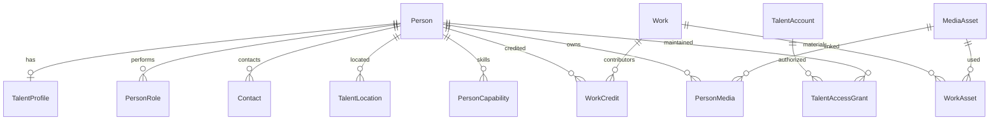
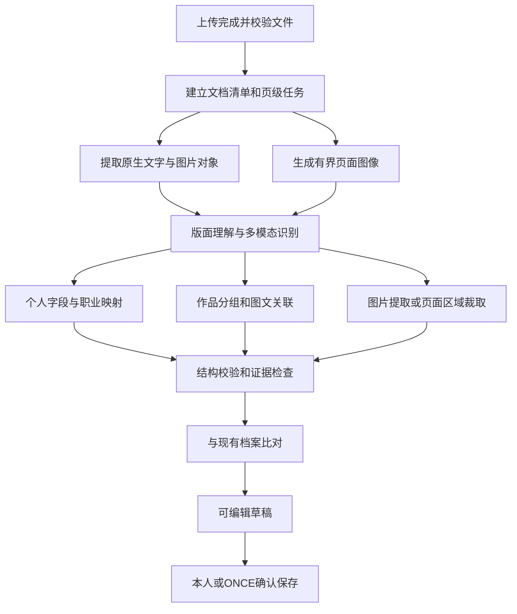
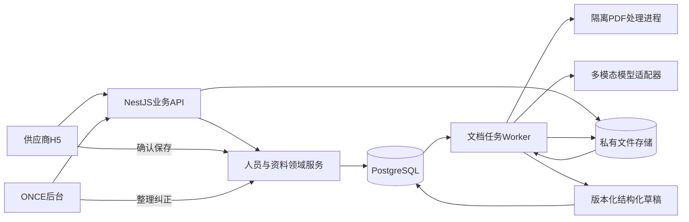

# ONCE供应商库第一版产品与系统架构方案

日期：2026年11月6日。用途：确定第一版产品范围、系统架构和开发顺序。状态：设计方案；文中新增模块、接口和指标为拟实施内容。

第一版的目标是把ONCE已经接触到的模特、导演、编剧、摄影师、灯光师、剪辑师、调色师等人员及其资料管理起来。供应商通过手机入口登录，上传已有PDF或图片，系统解析出个人信息、职业、作品和素材，生成可以直接修改的档案。**本人确认后直接入库，ONCE可以随时整理和纠正，供应商以后继续维护同一份档案。**

推荐沿用现有React、NestJS、PostgreSQL和私有文件存储，采用模块化单体业务服务、独立文档处理进程和持久化AI任务。正式人员数据只保留一套；人工录入、AI预填和后续修改通过同一套业务规则保存。

## 1 第一版的决定和范围

### 1.1 已明确的产品决定

| 决定 | 第一版落实方式 |
|---|---|
| 核心先管理人 | 以供应商目录和个人档案为中心，资料、职业和作品围绕人组织 |
| 多种制作职业 | 同一个人可拥有多个职业，共用身份、联系方式和账号，展示相应专业字段 |
| 供应商本人维护 | 提供手机入口，登录后更新自己的资料和作品 |
| AI解析是核心能力 | PDF中的文字、照片、作品和对应关系进入结构化草稿，支持扫描件与图片 |
| 本人确认后直接入库 | 普通建档和更新没有内部审核前置；ONCE保留整理、纠正和处理争议的能力 |
| 第一版规模1,000—10,000人 | 按10,000人验证目录、关联作品、批量解析与存储；并发量单独制定测试条件 |
| 传统业务系统融入AI | 数据模型、权限和保存行为由业务系统负责，AI负责识别、归类和预填 |

### 1.2 推荐默认值

入口先做响应式H5，同一后端以后可接小程序。用户已确认第一版预计管理1,000—10,000人，因此以10,000人作为首版容量验收规模。人数不等于同时在线人数；本方案另外给出查询并发和导入批次的测试条件，作为实施目标而非已验证结果。

登录推荐手机号验证码为主、邮箱验证码为补充，复用独立供应商账号体系。登录服务商、模型服务商和生产部署地域在技术验证阶段选定。第一版邀请链接或二维码由ONCE发放，登录成功后可开始填写；邀请建立允许加入的边界，正常提交由本人确认生效。

H5优先的原因是可复用现有Web前端、链接分发方便、表单和解析结果能够快速迭代。小程序在微信内回访和文件选择上可能更适合实际用户，但增加平台接入与发布维护。先在微信内浏览器、iPhone和Android实测从聊天或本地选择PDF的完整路径；如果这一步明显影响完成率，再增加小程序入口，共用账号映射、草稿与业务API。微信OpenID不替代Person ID。

### 1.3 必须交付的能力

1. ONCE创建人员草稿、登记小红书等发现渠道、上传现有资料、发出邀请。
2. 供应商登录、创建自己的档案或接手已明确归属本人的档案。
3. PDF、扫描PDF和图片的内容解析，产出字段、作品卡片和提取素材。
4. 本人可编辑的统一档案，包括多职业、专业字段、联系方式和作品。
5. 本人确认后直接保存；ONCE编辑与本人编辑都有版本和来源记录。
6. 后台人员列表、基础组合筛选、统一详情、资料状态和最近更新。
7. 新材料与旧档案的差异展示、疑似重复提示、归档与恢复。
8. 处理进度、部分失败、离开后恢复，以及已有资料的保留。

作品在这一版用于描述人的能力和经历，包含作品名称、本人职责、图片与链接。客户选角、报价、档期、订单、合同、支付和官网发布属于后续产品阶段。现有相关模块的数据继续保留，第一版日常导航集中在人员管理。

## 2 真实使用旅程

### 2.1 ONCE先收资料再邀请本人

ONCE在小红书找到一个人，在后台选择“添加供应商”，登记展示名或临时代号、已知职业、发现渠道与原始链接。可以立即上传PDF和图片，也可以先保存少量信息。

系统创建内部资料草稿并启动解析；ONCE查看预填结果，确认后建立正式人员档案。之后发送指向该档案的定向邀请。供应商完成账号验证和归属绑定后，在同一Person ID下继续维护。

没有必要要求供应商先登录才能收进现有资料。小红书链接首先作为来源记录保存，资料接收使用已经取得的文件；自动抓取小红书页面不属于这一条主链。

### 2.2 供应商收到通用加入链接

供应商打开ONCE邀请入口，完成手机号或邮箱验证。已有有效本人档案的账号直接进入自己的档案；新账号进入资料创建页。

用户可选择“上传现有资料”或“自己填写”。上传时系统先建立账号拥有的服务器草稿，再接收文件和启动解析，正式Person可以在首次确认时创建。这样上传不依赖一个尚未建立的正式档案。

解析后展示姓名、职业、城市、联系方式、专业资料和作品。用户修改、勾选保留内容并点击“确认入库”，系统在一个业务事务中创建人员、职业和选定关系，同时把已准备好的素材关联到本人。正常流程无需等待ONCE审批。

### 2.3 本人新增材料或更新档案

供应商进入“我的资料”，直接修改某个字段，或上传新模卡、简历和作品集。新解析结果按“可补充”“与当前不同”“重复内容”“需要你确认”组织。

例如新模卡写身高176，旧档案是175，页面同时呈现两者与原文位置，由本人明确选取。新作品默认作为新增候选；旧作品未出现在新PDF中，不表示应删除。用户勾选并确认后，选中的变化立即生效。

如果ONCE或另一个设备已经修改同一字段，保存时展示版本冲突，保留用户草稿，要求明确选择。版本冲突解决后仍由本人确认保存，不转成所有更新都必须审核的流程。

### 2.4 ONCE日常管理

ONCE在供应商库按姓名、职业、城市、技能和作品关键词找人，打开同一详情查看结构化信息和作品，必要时回到原材料核对。可以补充内部备注、纠正资料、归档无效档案，处理疑似重复和绑定争议。

管理首页展示待完善资料、解析异常、疑似重复和最近更新。关注点是当前谁能找到、资料缺什么、哪些信息变了。

## 3 页面和操作设计

### 3.1 供应商H5

| 页面 | 主要内容和动作 |
|---|---|
| 邀请与登录 | ONCE身份说明、手机号或邮箱验证、接续邀请上下文 |
| 我的资料 | 档案预览、编辑资料、上传新材料、作品、最近保存状态 |
| 上传材料 | 多文件队列、格式和大小提示、处理进度、可离开后返回 |
| 核对解析结果 | 预填字段、作品分组、提取图片、需要确认的项目、查看出处 |
| 修改与保存 | 分区编辑、未保存提醒、服务器草稿、明确确认生效 |

手机端采用“上传材料—核对资料—确认入库”三步主流程。第一屏说明已识别出多少项资料、多少个作品和多少张图片。只优先展开缺失、矛盾或归属不明的内容，其他预填项也可随时修改。

用户点击字段旁的“查看出处”，打开对应页面并定位区域。页面不向用户暴露任务租约、模型令牌、来源版本号等实现细节。进度使用真实阶段及完成页数，例如“已处理8／12页”，不能显示伪造百分比。

### 3.2 ONCE后台

日常导航建议为“供应商库、资料处理、管理设置”。人员详情内包含“概览、职业与能力、作品、材料、内部记录”。原作品库、项目和其他维护工具可继续从管理入口访问。

目录同时支持列表和卡片。模特卡片可突出照片与量尺；导演、编剧、灯光师等优先展示职业、城市、技能、代表作品和更新日期，不要求所有人提供头像或模卡。

默认展示人员状态、职业、城市、联系方式是否已提供、作品数、更新时间、维护方式。资料完整度只是缺项提示，不能当作人员能力或真实性评分。

### 3.3 第一版的基础筛选

姓名与别名、职业多选、常驻或服务城市、语言、技能、作品名称与描述关键词、资料状态、是否已认领、是否有作品、更新时间。模特职业另显示身高、量尺等已有专属条件。

同维度多选采用OR，不同维度采用AND。未知值保持未知。普通搜索只覆盖当前有权访问、已经保存生效的资料；未确认AI草稿不会混入正式人员结果。

## 4 人员模型和专业字段

### 4.1 一套人员身份和业务关系



“供应商”是面向ONCE业务的产品称呼，继续使用现有Person、TalentProfile和PersonRole承载个人资料，避免复制出另一套SupplierPerson。账号与人分开：先有人的资料、后来再认领，是正常情况。正式人员ID贯穿后续维护。

现有TalentProfile.internalSummary用于内部描述；本人提供给ONCE的自我介绍使用可明确授权的个人简介字段。内部备注、内部评价和他人的联系方式不进入本人端。

### 4.2 通用资料

| 字段组 | 第一版内容 | 保存原则 |
|---|---|---|
| 身份 | 展示名、别名、本人简介、封面或头像 | 一人一份主档，名字相同不自动合并 |
| 职业 | 一个或多个职业、职业说明 | 使用稳定职业代码，支持多职业 |
| 联系 | 手机、邮箱、微信等联系渠道 | 与登录凭证分开管理，沿用联系方式加密和可见性 |
| 地区 | 常驻城市、可服务地区 | 与作品拍摄地点分别记录 |
| 能力 | 技能、常用软件、工作语言 | 职业关联的能力和字典，不用全部塞入简介 |
| 外部身份 | 小红书主页或账号标识、其他作品链接 | 保存明确链接和来源，不凭相似昵称自动关联账号 |
| 作品 | 标题、简介、本人职责、时间精度、客户或品牌文字、图片、链接 | 未知项允许为空，作品与真实ONCE合作项目分开 |
| 管理 | 状态、维护人、内部备注、创建与更新时间 | ONCE维护，供应商端按白名单投影 |

首次确认的最小内容是展示名和至少一个职业。已验证账号提供联系本人所需的认证通道；是否向ONCE展示该手机号或邮箱，需要通过清晰的联系资料设置决定，不能自动把登录身份复制到一般档案DTO。

### 4.3 各职业最小表单

| 职业 | 第一版专业信息 | 作品展示重点 |
|---|---|---|
| 模特 | 身高、三围、鞋服尺码、量尺日期或未知、明确声明的风格和服务类型 | 模卡、素颜照、作品照、视频链接 |
| 导演 | 创作方向、作品类型、语言、项目职责 | 导演作品与本人职责、客户及年份 |
| 编剧 | 内容类型、擅长题材、语言、编剧职责 | 已获准提供的剧本简介或片段、作品链接 |
| 摄影师和摄影指导 | 拍摄方向、摄影技能、熟悉的设备或流程 | 作品图片、影像链接、摄影职责 |
| 灯光师 | 灯光职责、项目类型、设备与现场经验 | 案例、工作说明和可提供的现场素材 |
| 剪辑师 | 剪辑类型、软件、语言、工作技能 | 成片或片段链接、本人承担的工作 |
| 调色师 | 调色软件、色彩流程、作品类型 | 作品画面与明确标注的调色职责 |
| 化妆造型及其他 | 通用字段加与职业相关的能力项 | 代表作品、具体职责 |

第一版优先复用类型化能力、语言、地区和量尺表。需要新增的职业专属字段先形成版本化字段目录，再映射到类型化表或有严格Schema的职业扩展数据；不能开放任意JSON字段作为永久业务模型。

2026年11月7日进一步形成[字段、标签与职业模板升级方案](ONCE_FIELD_TAG_TEMPLATE_UPGRADE_20261107.md)：专业分类采用受控标签与多选，量尺保留数值和单位，软件等能力采用成组记录，内部整理标签独立管理；表单、校验、AI和搜索使用同一份版本化定义。该部分已开始落地：原有主档及原生业务表继续保留，新增目录驱动的专业字段、标签与成组记录；当前实现和验收边界见[字段模板实施记录](../release/SUPPLIER_FIELD_TEMPLATES.md)。

所有职业使用同一套入库与维护流程。扩展职业代码不要求再开发一个独立系统。初始字典要补齐编剧、灯光师和调色师，并支持城市与能力的管理入口；无法匹配字典的原文保留为待确认项，不擅自丢弃或变成新正式代码。

作品与本人署名分开管理。供应商可以维护自己创建且有权编辑的作品、本人职责和素材；如果关联的是多人共用的已有作品，只能维护本人获授权的部分，不能改掉其他参与者的署名或整个共享作品的信息。同名作品不自动合并，必要时由ONCE整理关联关系。

## 5 本人直接入库与后续纠正

### 5.1 三个动作分别判断

登录证明账号身份；绑定决定账号能维护哪一个人；确认保存决定哪些资料成为当前内容。供应商勾选确认不等于ONCE已核验其资质或工作经历。

通用邀请下的新供应商，首次确认即可创建正式人员和SELF维护授权。定向邀请接手既有档案时，使用邀请指定的已验证手机号或邮箱等明确归属依据。只有链接、同名或相同头像不能自动接手已有档案。无法确定归属的情况单独处理，不把正常新入库全部送入审核。

一个账号重复进入加入入口，应回到已绑定本人档案；重复点击确认使用同一回执，不再创建第二个人。材料出现多个主体时，用户选择本人的内容，系统不自动把所有人的信息并入一个人。

### 5.2 字段更新规则

| 内容 | 本人操作 | ONCE操作 |
|---|---|---|
| 本人通用资料、职业、技能、本人作品 | 查看、编辑、明确确认后生效 | 查看、整理、纠正，记录来源 |
| ONCE提供且明确开放给本人的历史资料 | 在可编辑字段上提交明确变更并保留旧来源历史 | 设置开放范围、纠正 |
| 内部备注、维护人、系统状态 | 不进入本人编辑表单 | 直接管理 |
| 已核验资质等核验状态 | 可提供材料和本人声明，不能把自己设为ONCE已核验 | 按实际依据核验或撤销核验 |
| 人员合并、他人档案归属 | 提示或申请处理 | 明确决定，保留身份关系 |

普通可编辑字段由当前版本上的明确保存更新，不规定“AI优先”“员工永久优先”或“新文件永远覆盖”。更改已经核验过的值后，旧核验只证明旧值；新值及时生效为本人声明或待核实内容，不能继承旧核验标记。系统保护字段仍由对应业务权限控制。

同字段并发变更采用版本检查和差异选择。后来的保存先看到对方的修改，再决定保留哪一项。保存的最小单位是用户确认的一组相关变更，例如一个作品和它的职责、图片一起成功或一起失败。

### 5.3 来源和产品体验

正常用户只需要“上传资料”“核对”“保存”。系统在后台记录本人、文件、页码、原文位置、确认时间和修改者。更改字段来源时保留旧依据，并明确关联新的本人声明或ONCE修改依据。

现有SourceAttribution要求内部reviewerId，现有Submission也主要按内部审核落地。直接入库需要新增真实的本人确认决策分支及数据库约束；不能填入一个假员工ID，让自动保存看起来经过人工审核。

## 6 PDF与图片解析架构

### 6.1 解析交付物

每份资料至少产出五类结果：可编辑字段、独立作品候选、可实际展示的素材文件、字段或作品的页面出处、未能确认的内容清单。原PDF保留为来源；日常管理使用解析后的数据。

一份12页摄影作品集的结果，应当可以是一个人的简介、两个职业、若干作品和各作品对应的图片，而不只是12张页面截图或一段摘要。无法确定作品边界的页面可以待本人拆分，不能默默把整份PDF认作一个作品。

### 6.2 推荐处理管线



1. **接收与检查。** 核对上传身份、文件类型、大小、文件摘要和当前可用性。检查页数、加密或损坏情况，建立明确的总页数与处理范围。
2. **本地内容提取。** 可复制文字的PDF先读取文字与位置；提取图片对象、页面尺寸、旋转信息。扫描件进入页面图像识别路径。
3. **页面理解。** 结合文字和页图识别个人介绍、量尺、项目标题、客户列表、作品图、联系信息和装饰元素。混合PDF按页选择处理方式。
4. **跨页整理。** 根据全文件的页面索引和相邻页上下文归并作品；每个分批结果保留页号和稳定候选键，跨批边界再核对。
5. **素材提取。** 原生图片提取与页面区域裁取结合使用，生成实际图片资产，并记录原文件、页码和区域。拼版模卡、扫描页和带遮罩的图片需要检查视觉结果。
6. **字段映射。** 将原文转成现有字段、职业代码、日期精度和单位；保留原文、转换过程和未知项。
7. **校验。** 检查Schema、字典、数值、页码、区域范围、图片存在性、角色与作品关联以及文件权限。
8. **形成草稿。** 聚合多个文件的结果，与当前档案比对，供本人选择、纠正、拆分作品和确认素材。
9. **应用变更。** 通过同一业务命令保存正式数据与关系，AI任务不直接更新人员表。

### 6.3 容易出错的材料要如何处理

| 材料情况 | 处理要求 |
|---|---|
| 原生文字PDF | 保留文字坐标，结合版面理解，避免仅按提取顺序拼接 |
| 扫描件或纯图片PDF | 使用页面图像进行OCR或多模态识别，输出内容位置 |
| 多栏简历 | 以版面阅读顺序识别，不能把日期和隔壁栏经历错配 |
| 一页多张作品照片 | 提取或裁取各图片区域，保留完整页供核对 |
| 多页同一作品 | 使用跨页候选分组，允许本人合并或拆分 |
| 一页多个作品 | 分开提取标题、职责和素材；模糊关系进入待确认 |
| 品牌Logo墙 | 保留为材料内容，不自动生成“为每个品牌完成过项目”的经历 |
| 多人通讯录或团队介绍 | 标记多主体，让用户选择本人内容，不自动修改他人档案 |
| 二维码和外部链接 | 提取为候选链接或区域供核对；解析过程不自动登录或抓取目标网站 |
| PDF中的脚本、指令和附件 | 作为文件内容处理，不授予模型执行系统命令的能力 |
| 加密、损坏或超限文件 | 给出原因和可操作的处理方式，已完成的其他文件继续可用 |

图片中的外貌不能用来推断身高、国籍、职业、年龄或真实工作经历。风格描述最多作为可编辑建议，不能替代本人职业声明。纯作品图片缺少职责时，应提示本人补充职责。

### 6.4 坐标与图片质量

统一保存页面旋转校正后的归一化坐标，原点为左上角，范围0到1；同时保留PDF原始坐标到渲染图的变换信息。模型返回0到999等其他坐标体系时，由适配层明确转换和校验。坐标不能超出页面；裁取结果要校验像素尺寸、空白比例和实际内容。

素材标注提取方式：原生图片、重绘图片或页面裁图。页面裁图不冒充原始摄影文件。提取过程保留水印和原内容，不能通过生成式修图补出不存在的细节。

pypdfium2可提取文字、渲染页面和导出图片，但其图片直接提取存在编码及遮罩限制；某些PDF需要以页面渲染结果生成正确的区域图。因此需要同时具备图片提取和页面裁取路径。[pypdfium2图片提取说明](https://pypdfium2.readthedocs.io/en/stable/python_api.html#pypdfium2.PdfImage.extract)

### 6.5 解析结果与草稿结构

解析结果采用版本化Schema，区分字段、作品、素材引用和出处。模型只引用系统提供的文件、页码、区域与候选键；正式资产ID和人员ID由服务端分配或验证。

以下为合成的结构示例，表达合同方向，完整字段和限额在实施时生成正式Schema：

```json
{
  "schemaVersion": "once-document-intake-v1",
  "personCandidate": {
    "displayName": "林禾",
    "roles": ["director", "photographer"],
    "evidence": [
      {"path": "displayName", "inputKey": "doc_1", "page": 1, "regionKey": "r_1"},
      {"path": "roles", "inputKey": "doc_1", "page": 1, "regionKey": "r_2"}
    ]
  },
  "fieldCandidates": [
    {
      "path": "locations.base",
      "rawValue": "上海",
      "normalizedValue": null,
      "status": "NEEDS_DICTIONARY_MAPPING",
      "evidence": [{"inputKey": "doc_1", "page": 1, "regionKey": "r_3"}]
    }
  ],
  "workCandidates": [
    {
      "clientKey": "work_1",
      "title": "夏日短片",
      "roleCode": "director",
      "assetCandidateKeys": ["image_4", "image_5"],
      "evidence": [{"inputKey": "doc_1", "pages": [3, 4]}]
    }
  ],
  "unknowns": [{"targetKey": "work_1", "field": "caseDate"}]
}
```

必需区分“没有值”“识别失败”“资料互相矛盾”和“用户要求删除”。模型生成的置信分不作为事实正确率或自动入库阈值；优先呈现可核对的出处、冲突和缺项。

## 7 技术路线与模型选择

### 7.1 文档解析方案比较

| 路线 | 能解决什么 | 对ONCE的限制 | 建议 |
|---|---|---|---|
| 纯文字抽取或OCR | 得到文字、部分位置 | 不能单独完成作品分组、职责理解和图片归属 | 作为管线中的基础步骤 |
| PDF直接交给多模态模型 | 较快完成文档理解与字段原型 | 实际素材导出、稳定坐标、分段恢复和费用仍需系统实现 | 用于选型对照和特定适配器 |
| Docling或PaddleOCR版面管线 | 页面结构、阅读顺序、区域、图片或表格提取 | 增加模型与部署资源，仍需业务字段和作品理解 | 在复杂样本收益明确时接入 |
| 本地PDF处理加多模态AI | 同时控制素材、来源、字段和处理阶段 | 需要实现两者之间的数据合同与校验 | 第一版推荐主线 |

OpenAI官方文档说明，具备视觉能力的模型接收PDF时会同时使用提取文字和页面图像；这验证了结合图文理解的可行性，但不替代ONCE的素材导出与人员模型。[文件输入文档](https://developers.openai.com/api/docs/guides/file-inputs)

Docling提供保留页面图像、图片图像并导出的示例；PaddleOCR的PP-StructureV3覆盖版面区域、OCR、阅读顺序和表格等模块。是否加入第一版，由同一组ONCE材料的图文对应效果和部署成本决定。[Docling图片导出示例](https://github.com/docling-project/docling/blob/main/docs/examples/export_figures.py)、[PaddleOCR版面解析](https://www.paddleocr.ai/main/en/version3.x/pipeline_usage/PP-StructureV3.html)

### 7.2 推荐组件边界

业务后端继续使用TypeScript。文档基础处理优先验证PDFium加pypdfium2，在隔离的Python进程中完成页数检查、文字提取、页面渲染及图片提取；通过版本化JSON清单和受控文件引用与Node Worker交互。Python进程不拥有人员数据库写权限或模型密钥。

该选择增加一个文档处理运行时，但不增加一套业务后端。锁定解析器、PDFium和镜像版本，随镜像保留依赖许可。pypdfium2采用Apache-2.0或BSD-3-Clause许可，PDFium及其依赖也有分发要求；PDFium不支持并发多线程调用，渲染并行使用受限进程。[许可说明](https://pypdfium2.readthedocs.io/en/stable/readme.html#licensing)、[并发说明](https://pypdfium2.readthedocs.io/en/stable/python_api.html#incompatibility-with-threading)

### 7.3 模型适配与选择原则

模型接口至少声明文字、图片、多图、结构化输出、单次输入限制和超时能力。直接PDF输入作为可选能力。现有OpenAI兼容协议可复用，但“协议兼容”不能作为已支持图片、JSON Schema或计费查询的证明。

如果主要在中国境内运行，优先把当地可用的千问视觉模型纳入首轮候选；已有获准OpenAI或Anthropic连接也可参与同样本对照。每次上线固定实际模型版本、地域和参数，避免在业务代码里依赖一个不断变化的“最新模型”名称。阿里云官方文档提供图像输入、文档解析和定位能力，结构化模式支持范围需要逐模型确认。[视觉理解](https://help.aliyun.com/zh/model-studio/vision)、[结构化输出](https://help.aliyun.com/zh/model-studio/qwen-structured-output)

现有AI SDK支持图片和文件消息，应用需要从当前纯文字prompt改为有界的多模态消息构造，并继续使用自己的输出校验。[AI SDK消息格式](https://ai-sdk.dev/docs/foundations/prompts)

模型适配器使用经过校验的图片字节、服务商文件接口或短期只读地址传递页图，具体方式按服务商能力选定；不能为了让模型读取材料而将原存储桶改为公开。传递过程同样受本次材料范围、预算和保留策略约束。

首轮只选择一个主模型投入试点。校验失败时优先缩小任务或让用户核对；第二个模型作为经过评测和授权的可选处理路径。不能把可能已执行的请求超时直接解释成免费失败，再自动切换模型重复发送。

结构化输出保证格式约束，不保证事实正确；仍需检查来源、图片关系、字典和数值。[结构化输出的错误处理说明](https://developers.openai.com/api/docs/guides/structured-outputs)

## 8 系统架构与模块职责



| 模块 | 负责的内容 | 写入边界 |
|---|---|---|
| 身份与访问 | 员工账号、供应商账号、邀请、绑定、当前权限 | 账号、会话和维护授权 |
| 人员与职业 | 人员主档、职业、能力、地区、联系方式 | 正式人员及专业事实 |
| 作品与媒体 | 作品、职责、素材集合、原件与派生素材 | 作品和资产关系 |
| 资料导入 | 解析任务、页面清单、结果聚合、差异 | 暂存草稿与处理记录 |
| AI适配 | 模型调用、输出格式、用量和请求结果 | 任务输出，不直接写正式档案 |
| 确认保存 | 本人或ONCE明确选择、版本检查、原子应用 | 调用各领域服务写正式数据 |
| 管理与维护 | 查询、归档、合并、导出、删除、恢复 | 遵守各对象的来源与依赖规则 |

业务API、现有后台Worker和文档Worker可以独立启动；业务代码与数据合同仍在同一仓库维护。文档处理不占用登录或普通查询请求，也不阻塞现有导入、媒体和删除任务。

第一版使用PostgreSQL持久任务和私有对象存储即可。队列领取、进度回写和结果应用使用短事务，PDF解码、渲染、OCR和模型网络调用在事务外执行。现有PrismaStore使用全局咨询锁，目录还会先加载候选关联图再核验分页；万人规模需要专项查询与锁等待测试，不能只扩大存储额度。具体改造见第12节。

## 9 数据结构如何演进

### 9.1 保留的业务主干

继续使用Person、TalentProfile、PersonRole、Contact、TalentLocation、PersonCapability、MeasurementSet、Work、WorkCredit、WorkAsset、MediaAsset和PersonMedia。已有供应商账号、邀请、维护授权、同意记录、命令回执和审计也继续使用。

现有TalentSubmission及Item已有服务器草稿、稳定候选键、依赖组和正式对象回填能力。优先扩展这一套草稿合同，使本人手填、内部整理和AI预填进入相同确认流程；不另外建立一套独立于人员主库的“AI供应商库”。

### 9.2 拟新增的文档处理实体

下表是逻辑实体设计。正式迁移时可以将小型、不可独立查询的结构嵌入严格Schema的任务清单，避免机械地一项一张表。

| 实体 | 关键内容 | 约束与用途 |
|---|---|---|
| DocumentParseJob | 工作区、真实发起主体、Submission、输入资产及摘要、任务阶段、状态、租约、尝试次数、处理范围、版本、授权快照 | 一份输入文件对应一项处理任务；同批多文件汇入同一个草稿 |
| DocumentPage | 任务、页号、原始与校正尺寸、旋转、文字/版面清单引用、页图引用、处理状态 | 页号在任务内唯一；可定位、分段恢复，完整标记成功与失败页 |
| MediaDerivation | 输入资产、派生资产、页号、区域、坐标变换、提取方式、解析器版本和摘要 | 可追溯每张图片来自哪里，支持导出、删除和重建 |
| ExtractionEvidence | 草稿项或字段路径、文件、页码、区域、原文引用、校验结果 | 将候选值与材料位置绑定；确认后关联正式字段证据 |

数据库存任务状态、关系和查询必要的元数据；较大的页面文字、版面JSON、页图与原始模型输出放在受控私有存储，并记录摘要、保留期限和访问范围。含联系方式的中间文字沿用敏感数据保护要求，不进入普通日志。

相同文件的本地解析缓存以文件摘要、解析器版本及访问范围作为键。跨账号不能因为文件摘要相同而暴露他人的材料；结果复用也要重新核验当前权限。

### 9.3 必须扩展的现有合同

| 现有约束 | 所需改变 |
|---|---|
| 本人基本文字投稿仅覆盖displayName、aliases、intro，项数也有小范围限制 | 增加版本化的完整资料草稿合同，覆盖职业、联系、地区、能力、量尺、作品与素材；继续设置合理总量上限 |
| 本人可见字段和历史材料受selfExposureManifest与用途范围约束 | 扩展明确的本人可见/可编辑白名单，逐项处理专业事实和素材；认领一个Person不自动开放其全部内部来源 |
| Submission主要区分TALENT和MACHINE，内部收资料流程不同 | 增加有明确权限的INTERNAL草稿分支，或由统一入口映射到现有内部草稿；推荐前者以统一多文件确认行为 |
| Submission保存主要依赖内部审核决定 | 增加本人确认直接应用命令，区分决策类型与执行状态；保留内部审核能力处理其他既有业务 |
| SourceAttribution的reviewerId要求内部员工 | 增加真实确认主体字段与互斥约束：内部核验记录员工，本人确认记录TalentAccount；历史内部审核数据保留原义 |
| AiRun、AiTask的actorId关联Membership | 改为有数据库约束的INTERNAL/TALENT主体联合结构，预算仍归工作区，不能用员工身份冒充供应商请求 |
| 现有AI输入与授权按已存在来源、文字任务设计 | 新增文档任务合同，允许授权范围内的暂存材料；扩展图片消息、页级输入和多项候选输出，保持旧文字任务的限制与兼容性 |
| 媒体资产围绕真实上传和现有派生物管理 | 增加明确的系统派生资产来源，保留原上传者和父资产关系；不能伪造上传记录来满足旧约束 |

草稿中的JSON只表达经过Schema约束的候选值。确认后职业、地区、技能、联系方式和作品关系写入对应类型化业务表，不能把可检索内容永久留在一个大JSON或PDF摘要里。

资料提供者、当前操作人和确认者分别留痕。例如ONCE代录供应商提供的PDF，提供者可以是供应商，发起解析和确认保存的主体仍是实际操作的员工；本人确认分支也不能抹去原来的文件来源。

### 9.4 上传时尚未存在正式Person的问题

账号拥有的Submission先承接上传和解析。新增文档AI处理同意，记录本次材料范围、用途、模型连接或处理服务范围、文本版本及有效状态，与正式入库的INTERNAL_DIRECTORY用途分别表达。ONCE内部材料沿用其实际来源和AI处理授权。

任务不要求提前制造一个虚假正式人员或虚假已核验来源。确认入库时，在当前有效授权下创建正式Person与维护关系，建立真实来源归因、字段证据和素材关系；全部通过后才把选中的暂存素材转为正式使用。

### 9.5 迁移原则

既有1—75号迁移保持原样，通过后续迁移增加表、索引、主体分支及数据库检查。历史记录回填为原来的INTERNAL决定，不能回填成“本人已确认”。历史PDF可以成为待解析任务，但重新解析的结果仍是草稿，不直接覆盖已有资料。

先迁移兼容读取，再启用新写入和本人确认功能；旧记录、新记录、导出重建和回滚关闭入口都要有测试。回滚应用功能时保留已确认数据，不能依赖删表回退。

## 10 任务状态、失败恢复与一致性

### 10.1 三种状态分别管理

文档处理状态建议为QUEUED、RUNNING、PARTIAL、READY、FAILED、CANCELLED；RUNNING另带检查、提取、识别、校验等阶段。PARTIAL表示部分页或文件已完成，用户能够看到明确的缺失范围。

草稿状态与处理状态分开：资料可编辑、本人已确认、正式保存成功是不同事件。模型请求的执行状态和费用结算状态也分开：收到可用结果但费用尚待核对，不应把可用草稿丢弃；没有可靠结果时不能宣称解析完成。

### 10.2 关键故障的处理

| 情况 | 处理方式 |
|---|---|
| 手机刷新、退出或网络中断 | 从服务器恢复草稿和进度；上传按现有存储能力恢复或重传该文件，已完成文件不重做 |
| 某页无法识别 | 保留已完成结果，标出失败页，允许补图、手填或重试该范围 |
| Worker中途退出 | 租约到期后由其他Worker领取；按文件摘要和阶段输出恢复，不重复发布同一结果 |
| 本地提取暂时失败 | 在资源与次数上限内重试；损坏、密码保护等确定错误直接提示 |
| 模型超时，可能已执行 | 进入结果核对流程；支持供应商请求查询时先查，不支持时明确需要新的尝试，不能盲目自动重发 |
| 模型输出字段错误 | 校验后保留可用部分；错误项待本人补充，必要时只重做失败页或字段 |
| 解析时本人已经修改表单 | 结果作为新建议合并到草稿，不直接覆盖本人输入 |
| 确认时档案已被ONCE修改 | 重新读取当前版本，展示冲突；保留尚未保存的选择 |
| 用户取消或权限已撤销 | 停止新调用；已在途请求不保证可撤回，但其晚到结果不能被发布或应用 |
| 某页超限、只处理选定范围 | 明确显示已处理页/总页数及未处理原因，不将截断结果标为全量完成 |

### 10.3 一次确认如何可靠保存

用户确认时提交草稿版本、人员与相关对象基线、所选候选键和幂等请求键。服务端重新校验账号、归属、来源、素材状态、依赖关系和字段版本，然后在短事务中保存选中事实、作品、职责、素材关系、归因、审计与命令回执。

依赖组内必须一致：选中一项作品时，关联的素材和本人职责必须可用；不能出现作品已创建但职责丢失。一个界面确认动作可包含多个明确选择的依赖组，受总量限制，避免一次数千条写入占用长事务。

素材字节先在事务外准备并校验摘要，数据库事务只确认采用与引用关系。数据库与对象存储之间不声称存在跨系统原子提交：事务失败后未采用对象由保留期和回收流程处理，不能在提交失败时删除其他记录仍在使用的资产。

重复点击确认返回原回执。响应丢失后先查询回执，不再新建人员。任务完成时使用租约、版本和授权epoch校验，旧Worker不能把过期结果写回当前草稿。

## 11 接口与前后端合同

以下是拟新增或升级的接口形态，用于明确边界，**不是当前已经实现的接口清单**。最终命名按现有路由风格统一。

| 能力 | 供应商端接口示意 | 语义 |
|---|---|---|
| 获取表单与职业字典 | GET /portal/profile-schema | 返回版本、可编辑字段和有效选项，不返回内部配置 |
| 保存完整资料草稿 | PATCH /portal/submissions/:id/profile | 校验并保存草稿，尚不改变正式档案 |
| 发起文件解析 | POST /portal/submissions/:id/document-jobs | 引用已完成上传的资产，返回202、任务ID和处理范围 |
| 查询解析结果 | GET /portal/document-jobs/:id | 当前状态、完成范围、候选结果、明确失败信息 |
| 重试或取消 | POST /portal/document-jobs/:id/retry 或 /cancel | 重试范围与费用状态明确，按当前权限判断 |
| 查看出处 | GET /portal/document-jobs/:id/pages/:page | 私有页图与区域定位，校验草稿归属和材料权限 |
| 本人确认保存 | POST /portal/submissions/:id/confirm | 首次建档或更新，返回Person ID、版本与回执；正常路径直接生效 |

ONCE后台有对应的内部入口，使用现有Membership权限，不复用供应商身份伪装调用。内部“整理后保存”和本人“确认入库”共享领域应用逻辑，但分别校验其真实权限和来源。

列表和详情返回经过授权的正式数据；任务接口只返回该主体可查看的草稿。模型输出必须服务端验证，不能让前端把任意模型JSON直接当成保存请求。

新增请求Schema、响应Schema、错误码、202异步语义和回执合同需要一起更新。当前合同生成器和本人入口策略脚本有精确允许列表，应增加对应规则与反例测试，不通过删除路由约束来绕过检查。

## 12 按10,000人设计容量、查询与费用

### 12.1 人数、材料量和并发分别估算

用户已确定人数范围；以下材料量是估算假设，需要用真实样本修正。以每人2份PDF、每份8MB、每份10页、每人选用12张各0.5MB的提取图片计算：

| 项目 | 1,000人 | 10,000人 | 计算口径 |
|---|---:|---:|---|
| 原PDF | 16GB | 160GB | 人数 × 2 × 8MB |
| 页面预览 | 4GB | 40GB | 人数 × 2 × 10 × 0.2MB |
| 选用的图片 | 6GB | 60GB | 人数 × 12 × 0.5MB |
| 基础材料小计 | 26GB | 260GB | 未含直接上传图片、视频、日志与数据库 |
| 加50%历史版本余量 | 39GB | 390GB | 容量规划假设，不代表实际保留率 |
| 再保留一份等量备份 | 78GB | 780GB | 简化预算；版本化存储和多副本按服务商实际计费 |

以上使用十进制MB/GB。万人场景可先按约0.5TB主存储额度和备份后的约1TB总预算空间规划，按真实材料增长调整。视频第一版以链接和已有上传能力为主，不进行全视频AI解析；大量视频会显著改变估算。

当前代码默认媒体有效字节约1GB、保留字节约2GB，媒体记录上限50,000。它们不能直接用于上述规模：仅正式选用图片就可能达到120,000张，解析中间图还会更多。需分别设置原件、正式派生素材、临时页图的字节与记录配额，避免提高一个总限额后失去资源控制。

### 12.2 目录查询的实际改造

当前目录已有参数化SQL候选筛选和最终分页，但中间会汇总各分面候选，加载关联图后核验字段，再计算分面。空条件时可能覆盖整个可见库；事务还持有全局咨询锁。万人规模下，作品数、证据数和来源数比Person行数更影响开销。

首版供应商目录应采用以下实现约束：

1. 将可在数据库准确表达的工作区、可见范围、来源有效性、职业、城市、技能和作品条件下推，按稳定顺序分批获取候选，避免每次加载整个关联图。
2. 当前页只装配列表需要的字段、封面和摘要；完整作品、材料与历史记录在详情中按需分页读取。
3. 默认每页20或50人，新增目录合同优先使用游标和是否有下一页。筛选选项首先来自有效字典，不要求每次打字重算全部精确分面计数。
4. 数量统计如异步或缓存返回，显示统计时间；当前授权或来源版本已变化时失效。未完成当前可见性核验的数量不作为精确总数展示。
5. 搜索、展示和导出必须遵循同一套来源与字段可见性语义。旧实现作为等价验证参考，不能为了快而绕过证据核验。
6. 依据实际执行计划增加工作区、人员外键、有效状态、职业/城市/能力代码、作品职责和更新时间索引。中文姓名、别名与作品关键词先用可解释的文字匹配，必要时验证pg_trgm；不以向量数据库作为首版依赖。

短事务内的授权、版本检查和保存先保持现有一致性；测量查询耗时与锁等待后，将高频只读查询改为有明确一致性语义的数据库快照，将任务领取改为有界原子领取。细化锁必须同时验证来源撤销、删除和并发保存，不能直接移除全局锁。

建议容量测试集包含10,000人、100,000条作品署名关系、120,000张正式图片，以及多来源和被撤销资料。先按20个并发目录/详情读取、5个并发资料保存和独立解析任务运行测量；这是测试工况，不是用户已确认的日常访问量。

### 12.3 文档处理限额与吞吐

第一版拟沿用PDF单文件50MB、图片30MB及解码像素上限等现有保护，并给新处理器增加独立页数和渲染预算。试点默认每批最多5个文件、每份PDF最多100页、每批累计200页；超过范围允许拆分或明确选择页段，不能静默丢页。

文档Worker先限制每账号1个在处理任务、每工作区2个处理槽位，其他任务持久排队。这里是文档任务限制，不替代现有上传并发限制。页面渲染按页进行，不把100页一次性解码进内存；多模态每批约4页起步，根据模型限制和样本质量调整，跨批作品通过全文件索引再次归并。

模型输入页图可先试长边约2048像素，小字区域按需补充更高清裁图；正式提取图片保留独立质量，不能只保存模型所用的低清缩略图。页像素、进程内存、运行时间和输出文件总量都要受限。

ONCE集中导入需要持久批次清单，记录每份文件对应的人或待确认主体、完成情况和错误。不能把文件夹里所有PDF拼成一个人的档案，也不能让一次批次失败要求全部重传。供应商主动操作优先于后台历史导入，同时避免后台任务长期饿死。

吞吐用实测平均任务时间估算。例如20,000份PDF，若每份平均90秒、2个槽位且没有速率限制，理论处理时间约250小时；这只是算例，尚未测试。首批历史导入和日常增量要分开排期，初始2个槽位不代表能在一天内完成万人材料。根据模型请求/令牌限额和预算增加Worker槽位，不能只按CPU数量扩容。

### 12.4 部署与费用控制

初始部署建议为业务API/前端、托管PostgreSQL、私有对象存储、独立文档Worker。使用外部模型API时不要求自建GPU；文档Worker可从独立4核8GB实例做样本验证，再根据峰值内存、解析并行度与队列等待调整。这是起测配置，不是容量保证。

每次解析记录文件数、实际处理页数、模型调用次数、输入/输出用量、用量是否已核对、耗时和失败原因。工作区设置单任务上限、日预算和月预算；在发起模型请求前预留预算，结算或核对后更新，超额时保留文件和手填入口。

费用按实际服务商计费单位计算：**模型费用＝各次请求的输入、图像/PDF和输出计费之和；总费用另加短信、存储、备份、下载流量和应用资源。** 不同模型对图像、PDF的计量不同，不用统一的“每页固定价”冒充准确报价。

评测阶段实测单份典型模卡、10页作品集、扫描简历的费用和耗时分布，再乘以历史导入量与每月更新量。第一版优先做好文件摘要去重、阶段缓存、只重试失败范围和明确预算；不为每个普通字段反复调用大模型。

## 13 当前项目的可复用部分与差距

### 13.1 代码基线判断

本方案基于仓库提交`3d117134f343ab382c52682bc57c1a1515472ec0`进行静态检查。现有项目已有React/TypeScript管理端、NestJS API、Prisma/PostgreSQL、独立供应商身份、人员专业模型、作品与素材、后台任务、AI调用记账和来源生命周期。业务基础较完整，建议在当前项目上集中改造人员入库与维护流程。

目前的差别主要是业务路径：界面和能力分散在目录、投稿审核、作品、机器摄取等模块，普通供应商无法通过一个统一入口完成全面资料维护，PDF也没有真正进入内容解析链路。

| 模块 | 当前证据与判断 | 第一版处理 |
|---|---|---|
| 人员与专业事实 | 已有人员、职业、地区、能力、语言、量尺、作品与署名等模型 | 保留，补字段字典与多职业表单 |
| 本人登录 | 已有独立TalentAccount、会话、邀请和维护授权 | 接通真实认证服务，简化正常加入和同档维护 |
| 本人维护 | 基本文字合同限于姓名、别名、简介；媒体和作品有独立入口 | 合并为完整资料草稿与统一本人确认流程 |
| 本人直接入库 | 现有关键分支仍依赖内部决定 | 新增真实本人确认分支，普通新增与更新立即生效 |
| PDF处理 | decoder对PDF生成灰色占位预览，明确不提取文字或OCR | 独立增加真实解析、素材导出和可编辑候选 |
| AI能力 | 已有文字任务、模型连接、预算、回执与错误处理 | 复用执行底座，新增多模态输入、文档输出和TALENT主体 |
| 职业与城市 | 初始职业缺编剧、灯光师、调色师，城市字典范围有限 | 扩充有效字典，支持规范映射和未知项补录 |
| 目录搜索 | 已有SQL候选与来源核验，但存在候选图加载和全局锁 | 新供应商目录按万人规模优化并验证语义等价 |
| 上传与存储 | 私有文件、暂存/正式媒体与生命周期基础可用 | 扩展系统派生素材、页图与任务配额，重新配置容量 |
| 真实上线证据 | 合并收尾文件仍将真实服务商、COS、物理手机等记为NOT_RUN | 在试点中补齐，不把历史代码检查当作上线验证 |

### 13.2 实施文件地图

下列是实施时的主要切入点，新增目录名仅为建议。

| 范围 | 现有文件或拟新增位置 | 主要工作 |
|---|---|---|
| 模型与迁移 | [prisma/schema.prisma](../../prisma/schema.prisma)、后续迁移 | 本人确认主体、文档任务、证据与派生关系 |
| 本人草稿与应用 | [talent-maintenance-schema.ts](../../packages/core/src/talent-maintenance-schema.ts)、[talent-maintenance.ts](../../packages/core/src/talent-maintenance.ts)、[talent-portal.ts](../../packages/core/src/talent-portal.ts) | 完整字段合同、直接入库、权限、冲突、回执 |
| 专业字段与界面 | [talent-fields.ts](../../apps/admin-web/src/talent-fields.ts)、[talent-maintenance-ui.tsx](../../apps/admin-web/src/talent-maintenance-ui.tsx)、[app-shell.tsx](../../apps/admin-web/src/app-shell.tsx) | 多职业表单、解析结果核对、日常导航 |
| 文档任务 | 拟新增apps/api/src/documents/、packages/core/src/document-intake相关模块 | 处理阶段、调度、校验、草稿聚合与来源定位 |
| 本地解析器 | 拟新增workers/document-parser/ | 有界PDF提取、渲染、图片导出与版本清单 |
| 媒体与Worker | [decoder.ts](../../apps/api/src/media/decoder.ts)、[media/worker.ts](../../apps/api/src/media/worker.ts)、[worker-main.ts](../../apps/api/src/worker-main.ts) | 原件接收保持清晰，长文档进入独立Worker，扩展派生资产 |
| 模型调用 | [model-client.ts](../../apps/api/src/ai/model-client.ts)、[ai-validation.ts](../../packages/core/src/ai-validation.ts)、[ai-dispatch.ts](../../packages/core/src/ai-dispatch.ts) | 多模态合同、能力检查、真实主体、未知请求处理 |
| 万人查询 | [talent-directory-query.ts](../../packages/core/src/talent-directory-query.ts)、[talent-directory-sql.ts](../../apps/api/src/talent-directory-sql.ts)、[prisma-store.ts](../../apps/api/src/prisma-store.ts) | 受权候选查询、分页投影、索引与事务边界 |
| 接口约束 | [generate-contract.ts](../../scripts/generate-contract.ts)、[talent-experience-surface-policy.mjs](../../scripts/talent-experience-surface-policy.mjs) | 新合同、路由允许列表与拒绝用例 |

现有机器摄取中的候选键、作品分组和依赖校验可以提炼复用，但供应商仍使用TALENT身份；不把本人端包装成MACHINE接口。

### 13.3 必须同步更新的规范

实施前同步更新[规范索引](../spec/00_README.md)、[PRD](../spec/04_PRD.md)、[开发约束](../spec/06_DEVELOPMENT.md)及[人才体验规范](../spec/15_TALENT_EXPERIENCE_V1_1.md)。旧的“PDF只保存附件”“不做OCR”“本人仅少量文字投稿”等阶段边界，应明确被本次新范围替代；权限、来源、审计、恢复和既有迁移不可改写的约束继续保留。

仓库要求Node 22系列和pnpm 10.14；本次执行环境版本与项目约束不同。正式实施前先统一运行时与依赖版本，再运行项目规定检查。本次方案研究没有因此更换环境或安装解析依赖。

## 14 数据维护、去重与生命周期

### 14.1 人员状态和资料状态分开

人员可处于有效或归档状态；是否本人已接手、是否本人确认过、哪些字段经过ONCE核验、资料是否完整，是不同维度。解析失败只影响该材料，不能把整个供应商标为无效。

ONCE手工建立的档案可先作为内部管理资料使用；本人接手后继续沿用同一ID。后台明确显示“ONCE整理”“本人已确认”等来源状态，避免把内部录入误认为本人声明。

### 14.2 重复人员和重复素材

姓名、别名、明确联系方式和外部账号可用于产生疑似重复提示，强弱依据分开展示。联系方式可能属于经纪人或工作室，同名和相同头像也不能证明同一人，因此第一版不自动合并人员。

本人不能通过查重接口枚举库中其他人的联系方式或档案。需要处理重复或归属争议时，由有权限的ONCE人员查看依据、选择合并目标。合并保留原ID映射和变更历史；未完成解析和旧草稿要重新绑定或重新校验，不能由旧任务直接写入合并后的人员。

同一用户同一范围内重复上传相同字节，可以提示复用已完成解析。相同图片出现在不同作品时，不自动删除其业务关联；不同版本PDF中重复出现同一作品，只提示关联既有作品，避免反复新建。

### 14.3 新增材料也要能删除、导出和恢复

| 对象或操作 | 必须覆盖的行为 |
|---|---|
| 原PDF与直接上传图片 | 私有访问、下载鉴权、来源与当前用途检查 |
| 文字、页图、模型输出与候选 | 归属草稿或人员，纳入保留期限、删除和访问记录，不形成另一份永久无人管理的副本 |
| 正式选用的提取图片 | 继承正确来源，独立记录派生关系与当前引用；撤销来源时检查受影响的正式使用 |
| 废弃或过期草稿 | 保留期到期后清理不再被使用的暂存物，正确归还容量 |
| 导出与迁移 | 包含人员、作品、素材关系、来源和必要的派生清单，能在另一实例重建 |
| 备份恢复 | 数据库与文件清单可核对；恢复epoch阻止旧任务回写，未知模型请求不因恢复自动重发 |
| 删除或归档 | 归档保留历史且从默认目录隐藏；删除按现有生命周期真正处理派生资产和中间文字 |

删除原PDF时，应先明确它仍支撑哪些字段和素材，按选定影响范围处理；有独立有效来源的共享作品不能被连带误删。数据库备份、对象存储版本和实际恢复必须一起验证，不能把“备份任务成功”当作“可恢复”。

### 14.4 文档与模型边界

解析器以受限进程运行，限制CPU、内存、时间、页面像素和输出体积，禁止任意网络访问与外部引用读取；处理目录不能访问业务密钥。当前“子进程不带密钥”并不等于完整隔离，需要在部署配置中落实文件与进程边界。

文档内容是待识别的数据，不能更改系统指令、调用外部工具或决定正式人员ID。模型访问通过服务端适配器，只发送本次任务必要材料。联系信息和模型原始响应不进入普通应用日志，内部备注也不随本人材料发送。

## 15 如何验收第一版

### 15.1 先建立ONCE自己的材料评测集

当前尚未拿到本任务的真实PDF样本，也未对真实模型进行试跑，下面是拟定验收方法和目标，不能当作已经达到的结果。

建议先收集约50份有代表性的材料，覆盖模特、导演、编剧、摄影师、灯光师、剪辑师和调色师，每类至少5份；同时覆盖原生PDF、扫描件、多栏简历、图多字少、一页多作品、跨页作品、多人介绍与联系方式冲突。复杂类型可以重叠。

其中约30份用于开发调优，约20份留作未参与调优的验证。人工标注可确认字段、作品边界、本人职责、可用图片和原文出处。对确实无法从原文判断的项，正确结果是保留未知或要求确认，不计为模型必须猜出的答案。

### 15.2 建议验收指标

| 指标 | 定义或目标 | 说明 |
|---|---|---|
| 客观字段准确率 | 有明确原文支持的已提取字段，正确率目标≥95% | 按字段类型分别报告；不能用大量简单字段掩盖联系方式错误 |
| 关键字段召回率 | 材料明确存在且纳入首版字段的内容，提取覆盖目标≥90% | 姓名、职业、城市、联系、量尺等分别统计 |
| 联系方式可靠性 | 目标≥99%准确率；模糊数字、跨主体内容必须提示核对 | 小样本不能证明总体99%；报告分母和错误明细，仍须本人确认 |
| 作品分组与职责 | 人工核对分组及本人职责对应，正确率目标≥90% | 单独列出跨页、一页多作品和Logo墙结果 |
| 图片可用性 | 选出的作品图片中，清晰、完整且对应正确的比例目标≥90% | 同时报应提取图片的召回率；不能靠少提图提高精度 |
| 来源可核对 | 所有从材料提取并采用的关键字段、作品、图片有可访问出处 | 无证据的建议只能标为建议，不冒充文件事实 |
| 目录性能 | 第12节工况下，常用目录请求服务端P95目标≤1秒 | 分别报告冷/热缓存、锁等待与数据规模，不把图片下载时间混入 |
| 解析体验 | 典型10页PDF处理P50目标≤2分钟、P95≤5分钟 | 上传与排队时间单独显示；模型和页图方案验证后调整目标 |
| 本人完成流程 | 试点用户≥80%能在无工作人员逐步指导下完成首次入库 | 至少覆盖各主要职业；记录卡在哪一步，不只收满意度 |
| 数据正确保存 | 重复确认不重复建人；确认内容可检索；并发修改不静默覆盖 | 以端到端用例和真实数据库断言验证 |

模型指标用于衡量预填质量，最终事实由本人或ONCE明确确认。先达到关键流程和正确性，再根据试点实际数据优化耗时与费用。

### 15.3 必须通过的业务场景

1. 新供应商从通用邀请进入，上传PDF、修改结果、确认后直接入库，无内部审核等待。
2. ONCE先建档和解析，定向邀请本人后仍维护同一Person ID。
3. 一个人同时是导演和摄影师，两个职业各自的作品和能力可维护、可筛选。
4. 七类主要职业都能完成通用字段、专业字段及作品的首次填写和后续更新。
5. 原生PDF、扫描PDF、单张图片都能产生结构化草稿；图文混合材料有真实提取图片。
6. 拼版模卡正确保留量尺与图片；遮罩、旋转页和带水印素材可正常核对。
7. 多页同一作品可以归并，一页多作品可以拆分，品牌Logo不会变成虚构项目。
8. 新PDF补充资料时保留旧作品；变更身高、联系或职责时显示差异。
9. ONCE纠正与本人更新发生冲突时，保留双方内容并要求明确选择。
10. 多人材料只选择本人部分；同名不自动接手他人档案，疑似重复不泄漏他人联系方式。
11. 手机刷新、短暂断网、重复点击和响应丢失后可恢复，不重复建人或重复调用模型。
12. 某页失败、文件超限、模型返回错误或超时，有明确处理范围和可继续操作的草稿。
13. 取消、来源撤销、人员合并或删除后，旧Worker结果不会重新出现或写入错误人员。
14. 本人端看不到内部备注、他人材料和无权下载的PDF；普通搜索不显示未确认草稿。
15. 在10,000人及关联数据测试集上，目录、保存与后台解析同时运行仍达到约定指标。
16. 使用真实认证服务、真实模型、实际对象存储和物理手机完成全链路，并实际执行一次备份恢复。

单元测试用于字段归一化、候选依赖、状态机和来源判断；真实PostgreSQL测试用于约束、并发和幂等；浏览器测试用于流程和草稿恢复；模型评测和真人试点分别提供质量与可用性证据。各类结果分别记录，Mock通过不能替代外部服务或业务验收。

## 16 实施顺序和阶段交付

第一版完成线包含真正的PDF内容解析。下面的分阶段交付用于尽早暴露问题，单独完成手工表单不能标记为本次第一版完成。

| 阶段 | 交付物 | 完成条件 |
|---|---|---|
| P0：材料验证与合同 | 代表样本、字段目录、解析路线对照、主模型和部署选项、费用测量、更新后的规范 | 至少一份模卡、一份扫描简历、一份多页作品集产出可核对字段与真实图片；明确现有代码改动边界 |
| P1：统一建档与本人直接保存 | 完整草稿、真实本人确认主体、多职业表单、内部整理、版本冲突 | 首次建档和更新无需普通内部审核；ONCE与本人维护同一档案；迁移兼容 |
| P2：解析纵向闭环 | 上传、页处理、多模态识别、作品素材候选、出处、核对、正式保存 | 实际PDF数据进入正式人员/作品/素材表，页面结果可检索与回查 |
| P3：职业覆盖与材料更新 | 七类职业、复杂图文、多文件聚合、新旧差异、部分失败和恢复 | 真实样本覆盖主要材料类型，所有职业可用；不以单一模特样例代表全行业 |
| P4：万人管理与历史导入 | 后台目录、搜索优化、批次清单、疑似重复、邀请接手、容量配置 | 指定数据量及并发工况通过；集中导入可恢复，不拖慢日常使用 |
| P5：真实试点与交付 | 外部服务验证、物理手机、20—30位真实供应商试点、质量/费用记录、恢复演练 | 业务场景与质量目标有实际证据，问题修复后再扩大导入和邀请范围 |

P1与P2的合同设计需要一起完成，避免先做一个无法接受解析结果的手工表单。P4的数据库和容量验证从P0就开始，不能等界面全部做完才发现搜索路径不适合万人规模。P3按样本问题推进，不持续堆叠与首版无关的职业复杂功能。

排期可先以2名工程师、兼职产品/测试支持、6—10周作为讨论用预算，前提是能获得代表材料、现有项目可持续复用、认证和模型接入不被外部条件阻塞。它不是已承诺工期；P0完成后按实际解析效果、迁移复杂度和性能改造量重估。开发交付优先按上表的可验证结果管理。

首版之后，再考虑自然语言找人、相似作品检索、定期提醒、客户候选分享、档期和报价。现有parse_search可以作为后续自然语言筛选的起点，仍需转换成受权限控制的结构化查询。首版AI投入优先用于减少本人建档和更新时的重复录入。

## 17 最终交付演示与证据范围

### 17.1 一次演示应证明什么

准备一位模特、一位导演或摄影师、一位剪辑或调色师。每人使用不同格式的真实材料完成登录、上传、核对、直接入库。ONCE能按职业、城市、技能或作品关键词找到他们，并看到作品、对应图片和材料出处。

随后上传一份更新材料，让系统只提出新增与变化；由本人确认后立即更新。ONCE再纠正其中一项资料，验证本人能看到当前可编辑值、内部备注仍受保护、并发操作不会丢数据。最后重新登录和恢复页面，档案、材料、作品和归属关系仍然完整。

这条演示走通且具备第15节的质量与规模证据，才符合“先把人和资料管理起来”的第一版目标。

### 17.2 已确认与待验证的边界

已由用户明确：多职业人员库、本人维护、AI实际解析PDF与图片、本人确认直接入库、ONCE可整理纠正、人数1,000—10,000。

本方案推荐但尚待技术与样本验证：H5优先、本地PDF处理加多模态模型、PDFium/pypdfium2组件、具体模型与认证服务、页面限制和并发配置、性能/质量目标及排期。真实文件的页数、尺寸、语言、扫描比例和每月更新量，需要在P0采样后用于修正预算；这些不影响本次核心架构决定。

本次产出为设计文档和代码/官方资料研究，未修改业务代码，未实现或测试新增解析能力，未调用真实供应商材料进行模型评测，未执行生产迁移或部署。现有项目部署边界以[合并收尾记录](../release/MERGE_CLOSEOUT_20261005.md)为据。

### 17.3 外部技术依据

以下均为本次研究查阅的官方文档或官方仓库，查阅日期为2026年11月6日。它们证明组件能力和限制，不证明ONCE样本的实际准确率或价格。具体SDK与模型版本在实施时锁定。

- [OpenAI PDF输入](https://developers.openai.com/api/docs/guides/file-inputs)：直接PDF输入会结合文字与页面图像；仍需业务侧管理素材、来源与成本。
- [OpenAI结构化输出](https://developers.openai.com/api/docs/guides/structured-outputs)：格式约束不能替代事实校验。
- [pypdfium2说明与许可](https://pypdfium2.readthedocs.io/en/stable/readme.html)、[API与图像提取](https://pypdfium2.readthedocs.io/en/stable/python_api.html)：本地文字、渲染与图片提取能力，以及遮罩和并发等限制。
- [Docling图片导出示例](https://github.com/docling-project/docling/blob/main/docs/examples/export_figures.py)：页面和图片对象导出的实际API路径。
- [PaddleOCR PP-StructureV3](https://www.paddleocr.ai/main/en/version3.x/pipeline_usage/PP-StructureV3.html)：版面、OCR、阅读顺序和结构化解析的可选管线。
- [阿里云视觉理解](https://help.aliyun.com/zh/model-studio/vision)、[千问结构化输出](https://help.aliyun.com/zh/model-studio/qwen-structured-output)：境内候选多模态接口与结构化模式能力，需逐模型验证。
- [AI SDK消息格式](https://ai-sdk.dev/docs/foundations/prompts)：图片和文件消息接入方式；代码实现须使用本项目锁定版本对应API。
