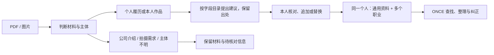

# 真实材料校准：字段怎样落到供应商身上

本次校准基于用户本机提供的 27 个 PDF 与 1 个 PPTX。对 PDF 做了完整原生文字盘点，并抽看代表页面；不是对 912 页逐页人工验收，也不是外部 AI 模型准确率评测。原件、可识别正文、联系方式、访问码与照片均未放入公开工程样例。

最关键的发现是：入口收到的文件不一定是某个人的履历。公司介绍、团队作品册和拍摄需求板都出现在这批材料中。必须先认清材料用途和主语，再决定哪些内容可以填到人身上。

| 在真实材料中出现的结构 | 处理方式 |
|---|---|
| 一个人兼导演、摄影、剪辑、调色等职责 | 保持一个人，关联多个职业；作品中的具体职责另记在作品贡献中 |
| DP、摄影师、掌机、跟焦、DIT 等表述 | 保留职责差异，不把所有词都自动归并为同一职业 |
| 斯坦尼康、Trinity、MOCO、胶片操作 | 受控多选标签；新词先留原文，整理为选项后才能进入正式标签 |
| 软件及 AI 制作工具 | 关联职业与已登记能力，熟练度按条填写；软件名称不自动变成新目录项 |
| 稳定器、翻译等资格声明 | 保留资格名称、机构和明确日期，默认为未核验；声明不等于证明已通过核验 |
| 翻译履历中的语言、方向、场景 | 分开记录工作语言、原文到目标语言的方向，以及现场、陪同、会议等服务方式 |
| 只有年份或年月的教育、工作经历 | 保留原文时间，可填写明确年份，不猜具体日；完整日期才进入日期字段 |
| “从业 N 年”与个人求职薪资 | 不永久当作当前从业年限，不把求职月薪当作供应商日价 |
| 作品中的模特、演员面孔 | 不据此认定为供应商本人，不自动设为本人头像 |
| 合作艺人或品牌列表 | 作为合作提及或本人声明；不自动产生已核实作品贡献 |
| 双语重复介绍、页面页脚 | 不自动拆成两个人或多个独立项目 |
| 私有分享链接及访问方式 | 不自动外部抓取；访问码不进入公共样例或模型输出的普通资料字段 |

这批材料主要校准了摄影、导演、后期及翻译。模特量尺、其他职业的完整用词和外部模型在复杂版式中的准确率，继续通过小批量真实试点验证。详细实施及当前验收证据见[字段模板实施记录](../release/SUPPLIER_FIELD_TEMPLATES.md)。
